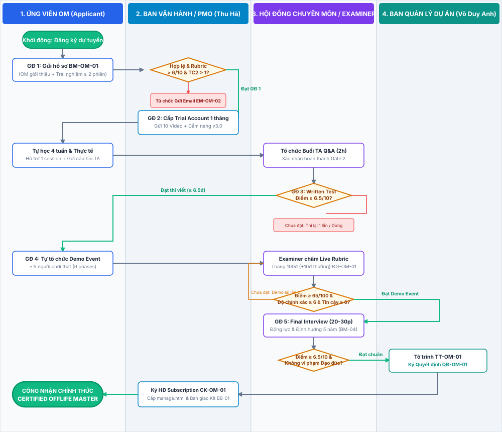
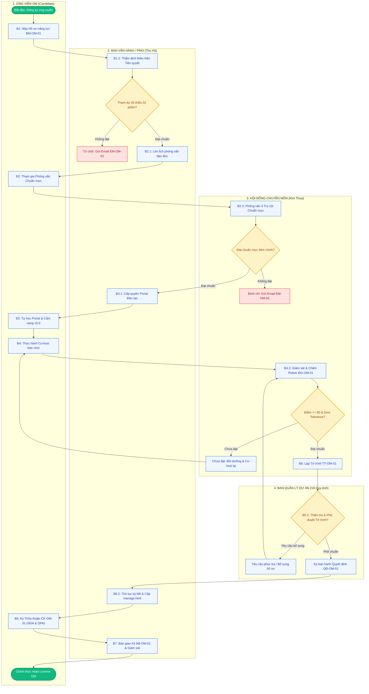

# QUY TRÌNH TIÊU CHUẨN (SOP): TUYỂN CHỌN, ĐÀO TẠO & CẤP QUYỀN HOẠT ĐỘNG OFFLIFE MASTER (OM)

> **Mã hiệu văn bản:** `SOP-OM-01` | **Phiên bản:** `2.0 (Chuẩn hóa Pháp lý & Vận hành)` | **Ngày ban hành:** `28/10/2026`  
> **Căn cứ pháp lý:** Nghị định số 30/2020/NĐ-CP của Chính phủ về công tác văn thư; Nghị định số 13/2023/NĐ-CP về Bảo vệ dữ liệu cá nhân (DPA); Tài liệu Đào tạo OffLife Master v3.0; Khung Danh mục 102 Chuyên đề Quản trị Thực tế OnLife.  
> **Tài liệu tham chiếu trực tuyến:** [Ứng dụng Tương tác SOP Online](https://nguyetnguyen-kxxd.github.io/quy_trinh_tuyen_om_interactive/)

---

## MỤC LỤC TỔNG QUAN

1. [Mục Đích, Phạm Vi & Phân Định Trách Nhiệm Nghề Nghiệp (5W1H & RACI)](#1-mục-đích-phạm-vi--phân-định-trách-nhiệm-nghề-nghiệp-5w1h--raci)
   - 1.1. Mục Đích Ban Hành & Hai Trụ Cột Năng Lực
   - 1.2. Lộ Trình Phân Cấp Chức Danh Điều Phối Viên (4 Cấp Bậc)
   - 1.3. Bảng Ma Trận So Sánh Toàn Diện 4 Cấp Bậc Chức Danh
   - 1.4. Cơ Chế Quản Trị Vòng Đời License (Thăng Cấp, Duy Trì, Cảnh Báo & Thu Hồi)
   - 1.5. Phân Định Ranh Giới Trách Nhiệm: OM vs MC vs Giảng Viên
   - 1.6. Hệ Thống 3 Nguyên Tắc Hoạt Động & Quy Chế Zero Tolerance
   - 1.7. Giới Hạn Thẩm Quyền & Các Hành Vi Bị Nghiêm Cấm
   - 1.8. Ma Trận Phân Định Trách Nhiệm (RACI Matrix)
2. [Quy Trình 7 Bước Tuyển Chọn, Đào Tạo & Cấp Phép OM](#2-quy-trình-7-bước-tuyển-chọn-đào-tạo--cấp-phép-om)
3. [Sơ Đồ Điều Hành Phân Làn (Swimlane Flowchart)](#3-sơ-đồ-điều-hành-phân-làn-swimlane-flowchart)
4. [Ma Trận 11 Biểu Mẫu & Tra Cứu Nghiệp Vụ (Document Matrix)](#4-ma-trận-11-biểu-mẫu--tra-cứu-nghiệp-vụ-document-matrix)
5. [Trình Sát Hạch Đánh Giá Năng Lực Thực Hành Trực Tuyến (Rubric ĐG-OM-01)](#5-trình-sát-hạch-đánh-giá-năng-lực-thực-hành-trực-tuyến-rubric-đg-om-01)
6. [Kho Biểu Mẫu & Toàn Văn 11 Văn Bản Quản Trị Chuẩn Hóa](#6-kho-biểu-mẫu--toàn-văn-11-văn-bản-quản-trị-chuẩn-hóa)

---

## 1. MỤC ĐÍCH, PHẠM VI & PHÂN ĐỊNH TRÁCH NHIỆM NGHỀ NGHIỆP (5W1H & RACI)

### 1.1. Mục Đích Ban Hành
Quy trình này quy định trình tự thủ tục, tiêu chí đánh giá định lượng và thẩm quyền phê duyệt đối với công tác tuyển chọn, bồi dưỡng nghiệp vụ tập trung và cấp Giấy phép điều phối (License) cho chức danh **OffLife Master (OM)** trực thuộc Dự án OffLife.

> [!NOTE]
> **HAI TRỤ CỘT NĂNG LỰC CHUẨN HÓA CỦA VỊ TRÍ OFFLIFE MASTER (OM):**
> 1. **Năng lực Chuyên môn (Professional Competency):** Làm chủ hệ thống thông số mô phỏng (tương tác định lượng 3 nguồn lực Tiền - Sức khỏe - Trí tuệ); điều phối chính xác 7 bước vòng chơi hàng năm; quản trị các biến cố tài chính, vỡ nợ, đột tử và kiểm soát thời lượng phiên chơi (40 năm mô phỏng trong 180 phút).
> 2. **Tuân thủ Chuẩn mực Đạo đức & Liêm chính (Ethical Compliance & Integrity):** Tuyệt đối giữ tính khách quan; kiểm soát xung đột lợi ích; bảo vệ dữ liệu cá nhân của người tham gia; không đưa ra lời khuyên đầu tư tài chính cá nhân ngoài đời thực.

---

### 1.2. Lộ Trình Phân Cấp Chức Danh Điều Phối Viên (4 Cấp Bậc)

Nhằm xác lập lộ trình phát triển nghề nghiệp minh bạch, bảo đảm chuẩn hóa chất lượng điều phối trên toàn hệ thống và tạo động lực cống hiến lâu dài, Dự án OffLife thiết lập **Hệ thống 4 Cấp bậc Chức danh Điều phối viên**:

$$\text{Cấp 0: Người tham gia (Player)} \longrightarrow \text{Cấp 1: OM Tập sự (Apprentice OM)} \longrightarrow \text{Cấp 2: OM Đạt chuẩn (Certified OM)} \longrightarrow \text{Cấp 3: OM Cao cấp (Senior Lead OM)}$$

#### 1. Cấp 0: Người Tham Gia (Player / Explorer)
- **Định vị:** Cá nhân trải nghiệm tiến trình mô phỏng 40 năm cuộc đời (23 đến 62 tuổi) trong buổi workshop OffLife để nhận thức về quản trị cân bằng 3 nguồn lực Tiền - Sức khỏe - Trí tuệ.
- **Tiêu chuẩn đầu vào:** Đăng ký tham gia sự kiện công khai hoặc sự kiện nội bộ do OM tổ chức.
- **Quyền hạn & Quyền lợi:** 
  * Được tham gia trọn vẹn phiên mô phỏng; nhận Bộ Phiếu ghi cá nhân (Player Sheet);
  * Tham gia phiên đúc kết bài học OnLife cùng OM điều phối;
  * Thực hiện khảo sát đánh giá chất lượng phục vụ của OM (`BM-OM-04`).
- **Điều kiện chuyển tiếp lên Cấp 1 (OM Tập sự):**
  * Tham dự trọn vẹn tối thiểu **02 phiên OffLife thực tế** (có xác nhận của Lead OM trong hồ sơ);
  * Tự nguyện nộp Phiếu Đăng ký Dự tuyển & Khai trình Năng lực (`BM-OM-01`).

#### 2. Cấp 1: OM Tập Sự (Apprentice OM / Trainee)
- **Định vị:** Ứng viên đã vượt qua vòng thẩm định hồ sơ tiên quyết và phỏng vấn chuẩn mực đạo đức, đang trong giai đoạn đào tạo nghiệp vụ tập trung và sát hạch thực địa có giám sát.
- **Tiêu chuẩn năng lực:**
  * Vượt qua vòng phỏng vấn chuẩn mực đạo đức với Hội đồng Chuyên môn đạt điểm số $\ge 75/100$ (`BM-OM-02`);
  * Hoàn thành 100% thời lượng 5 Module Video bài giảng trên Portal Learn (`BM-OM-03`);
  * Nghiên cứu thấu đáo Tài liệu Đào tạo OffLife Master v3.0 (12 phần) và Khung 102 Chuyên đề OnLife;
  * Đạt điểm bài kiểm tra lý thuyết trực tuyến tổng hợp từ $\ge 90/100$ điểm.
- **Thẩm quyền & Giới hạn hoạt động:**
  * **Chỉ được tham gia với tư cách Điều phối phụ (Co-host)** tại các bàn chơi dưới sự giám sát và hướng dẫn trực tiếp của Senior Lead OM;
  * **Tuyệt đối chưa được tổ chức hoặc điều phối độc lập** bàn chơi khi chưa có Quyết định bổ nhiệm chính thức;
  * Chưa được cấp tài khoản quản trị cá nhân (`manage.html`);
  * Không được tự ý thu phí dịch vụ điều phối độc lập từ người tham gia;
  * Thời hạn tập sự tối đa: **30 ngày** kể từ ngày thông báo kết quả phỏng vấn.
- **Điều kiện thăng cấp lên Cấp 2 (Certified OM):**
  * Thực hành điều phối có giám sát (Co-host) đạt điểm Rubric $\ge 80/100$ (`ĐG-OM-01`);
  * Không vi phạm bất kỳ tiêu chí nào thuộc Quy chế Zero Tolerance;
  * Được Hội đồng Chuyên môn lập Tờ trình đề xuất (`TT-OM-01`) và Ban Quản lý Dự án ký Quyết định phê chuẩn (`QĐ-OM-01`);
  * Ký kết đầy đủ Thỏa thuận cam kết pháp lý (`CK-OM-01`: Hợp đồng dịch vụ + NDA + DPA).

#### 3. Cấp 2: OM Đạt Chuẩn / Chính Thức (Certified OM)
- **Định vị:** Điều phối viên chính thức được Dự án OffLife ủy quyền hành nghề độc lập, đại diện cho chuẩn mực chuyên môn và uy tín liêm chính của thương hiệu OffLife.
- **Tiêu chuẩn năng lực:**
  * Nắm giữ Giấy phép điều phối (License) chính thức có thời hạn hiệu lực **01 năm**;
  * Đã ký kết hợp đồng dịch vụ và bản cam kết pháp lý bảo vệ dữ liệu (`CK-OM-01`);
  * Tiếp nhận Bộ công cụ điều phối tiêu chuẩn nguyên seal (`BB-OM-01`);
  * Làm chủ kỹ thuật điều hành 7 bước vòng chơi và phương pháp đặt câu hỏi truy vấn bài học (Debriefing) theo chuẩn 12 phần;
  * Duy trì chỉ số hài lòng của khách hàng (CSAT) sau mỗi phiên chơi đạt trung bình $\ge 4.5/5.0$ sao (`BM-OM-04`).
- **Thẩm quyền & Quyền lợi hoạt động:**
  * **Toàn quyền độc lập tổ chức và điều phối bàn chơi tiêu chuẩn** (quy mô từ 4 đến 8 người chơi/bàn);
  * Được cấp tài khoản quản trị cá nhân độc lập trên hệ thống số (`manage.html`);
  * Được phép cung ứng dịch vụ điều phối workshop cho cộng đồng, doanh nghiệp, tổ chức giáo dục và câu lạc bộ theo khung giá quy định của Dự án;
  * Được hưởng thù lao điều phối, cơ chế chia sẻ doanh thu và chính sách phân phối Bộ công cụ OffLife theo Quy chế Tài chính nội bộ;
  * Được tham gia các chương trình đào tạo nâng cao, cập nhật tính năng mới định kỳ 2 tuần/lần từ đội ngũ R&D.
- **Nghĩa vụ duy trì License thường niên:**
  * Thực hiện tối thiểu **02 phiên điều phối/quý** (hoặc tối thiểu **08 phiên/năm**);
  * Đảm bảo điểm đánh giá chất lượng CSAT trung bình $\ge 4.5/5.0$ sao và không nhận phản hồi tiêu cực về thái độ/liêm chính;
  * Hoàn thành các kỳ kiểm chuẩn nghiệp vụ thường niên và cập nhật phiên bản quy tắc mới.
- **Điều kiện thăng cấp lên Cấp 3 (Senior Lead OM):**
  * Duy trì hoạt động ở cấp Certified OM liên tục tối thiểu **06 tháng**;
  * Trực tiếp điều phối thành công tích lũy tối thiểu **30 phiên chơi** với điểm CSAT trung bình $\ge 4.8/5.0$ sao;
  * Được tối thiểu 02 thành viên Hội đồng Chuyên môn đề cử và vượt qua kỳ sát hạch năng lực Cố vấn / Huấn luyện viên.

#### 4. Cấp 3: OM Cao Cấp / Trưởng Nhóm Chuyên Môn (Senior Lead OM / Master Trainer)
- **Định vị:** Chuyên gia điều phối kỳ cựu, Cố vấn phương pháp luận, Giám khảo sát hạch trực thuộc Hội đồng Chuyên môn và là Người dẫn đường (Mentor) cho các thế hệ OM kế cận.
- **Tiêu chuẩn năng lực:**
  * Có bề dày kinh nghiệm thực chiến xuất sắc ($\ge 30$ phiên điều phối, thâm niên $\ge 06$ tháng);
  * Am hiểu sâu sắc bản chất khoa học hành vi, quản trị xác suất và ánh xạ nhuần nhuyễn 102 chuyên đề thực tiễn OnLife;
  * Sở hữu kỹ năng xử lý khủng hoảng tâm lý người chơi vượt trội (xử lý tình huống vỡ nợ, đột tử, áp lực tài chính);
  * Được Trưởng Ban Quản lý Dự án (Project Lead) ban hành Quyết định bổ nhiệm chức danh Senior Lead OM.
- **Thẩm quyền & Trọng trách đặc thù:**
  * **Chủ trì các sự kiện mô phỏng quy mô lớn:** Điều hành các phiên hội trường đa bàn chơi (từ 50 đến 200 người tham gia đồng thời);
  * **Thành viên Hội đồng Chuyên môn:** Trực tiếp tham gia phỏng vấn ứng viên (`BM-OM-02`), giám sát các phiên Co-host, chấm điểm lượng hóa Rubric (`ĐG-OM-01`) và ký Tờ trình phê duyệt cấp phép (`TT-OM-01`);
  * **Huấn luyện & Mentor:** Trực tiếp kèm cặp, hướng dẫn và truyền thụ kinh nghiệm cho các Apprentice OM trong giai đoạn tập sự;
  * **Tham gia Ban Nghiên cứu & Cải tiến Sản phẩm (Product R&D):** Đóng góp ý kiến sửa đổi cơ chế trò chơi, thuật toán số phận/may mắn và biên soạn các chuyên đề OnLife mới;
  * **Quyền lợi & Đãi ngộ cao cấp:** Hưởng thù lao chuyên gia cao cấp, phụ cấp công tác chấm thi sát hạch và tỷ lệ phân chia doanh thu sự kiện quy mô lớn tối ưu nhất.

---

### 1.3. Bảng Ma Trận So Sánh Toàn Diện 4 Cấp Bậc Chức Danh Điều Phối

| Tiêu Chí So Sánh | Cấp 0: Người Tham Gia (Player) | Cấp 1: OM Tập Sự (Apprentice OM) | Cấp 2: OM Đạt Chuẩn (Certified OM) | Cấp 3: OM Cao Cấp (Senior Lead OM) |
| :--- | :--- | :--- | :--- | :--- |
| **Đối tượng & Đầu vào** | Cá nhân đăng ký tham gia workshop | Người chơi tham gia $\ge 02$ phiên + Đạt phỏng vấn $\ge 75$đ | Hoàn thành đào tạo + Đạt Rubric Co-host $\ge 80$đ | Certified OM $\ge 06$ tháng + $\ge 30$ phiên + CSAT $\ge 4.8$ |
| **Trạng thái Pháp lý** | Khách hàng trải nghiệm | Học viên đào tạo tập sự | **Được cấp License chính thức (QĐ-OM-01)** | **Quyết định bổ nhiệm Chuyên gia Hội đồng CM** |
| **Tài khoản Hệ thống** | Không có | Tài khoản học tập Portal Learn | **Tài khoản quản trị riêng (`manage.html`)** | **Tài khoản Quản trị viên Master (Full Admin)** |
| **Thẩm quyền Bàn chơi** | Không | Chỉ điều phối phụ (Co-host có giám sát) | **Độc lập mở bàn tiêu chuẩn (4 - 8 người/bàn)** | **Chủ trì đại sự kiện đa bàn (50 - 200 người)** |
| **Vai trò Sát hạch & Đào tạo** | Đánh giá khảo sát CSAT | Tham gia sát hạch thực tế | Hướng dẫn luật chơi cho người tham gia | **Giám khảo chấm thi, Phỏng vấn, Mentor OM** |
| **Quyền lợi Kinh tế** | Tiếp nhận giá trị bài học cuộc sống | Được hỗ trợ phụ cấp Co-host (nếu có) | **Thù lao điều phối + Phân chia doanh thu bàn** | **Thù lao chuyên gia + Phụ cấp giám khảo + R&D** |
| **Chỉ số Duy trì (KPI)** | Không | Hoàn thành đào tạo trong vòng 30 ngày | **Tối thiểu 08 phiên/năm + CSAT $\ge 4.5/5.0$** | **Tối thiểu 20 phiên/năm + Đào tạo $\ge 03$ OM mới** |

---

### 1.4. Cơ Chế Quản Trị Vòng Đời License (Thăng Cấp, Duy Trì, Cảnh Báo & Thu Hồi)

1. **Cơ chế Thăng cấp (Promotion Protocol):**
   - *Từ Player lên Apprentice OM:* Tự động kích hoạt khi nộp `BM-OM-01` kèm xác nhận $\ge 02$ phiên tham dự và đạt phỏng vấn `BM-OM-02`.
   - *Từ Apprentice OM lên Certified OM:* Hội đồng Chuyên môn lập Tờ trình `TT-OM-01` sau khi đạt điểm Rubric $\ge 80/100$, hoàn tất ký hợp đồng `CK-OM-01` và nhận License `QĐ-OM-01`.
   - *Từ Certified OM lên Senior Lead OM:* Xét duyệt định kỳ 6 tháng/lần dựa trên hồ sơ chứng minh $\ge 30$ phiên điều phối, báo cáo điểm CSAT $\ge 4.8$ sao và bài đánh giá năng lực sư phạm/mentor.

2. **Cơ chế Duy trì & Tái cấp License Thường niên (Renewal Protocol):**
   - Giấy phép điều phối License có thời hạn hiệu lực **01 năm (12 tháng)** kể từ ngày ký Quyết định bổ nhiệm.
   - Trước ngày hết hạn 30 ngày, hệ thống tự động trích xuất lịch sử điều phối:
     * Nếu hoàn thành $\ge 08$ phiên/năm và điểm CSAT trung bình $\ge 4.5$ sao: **Tự động gia hạn License thêm 01 năm**.
     * Nếu chưa đủ số phiên: OM phải tham gia phiên kiểm chuẩn cập nhật nghiệp vụ với Senior Lead OM để được xem xét gia hạn.

3. **Cơ chế Chế tài, Cảnh Báo, Tạm Đình Chỉ & Thu Hồi Vĩnh Viễn (Disciplinary & Revocation):**
   - **Mức 1 - Cảnh báo Chuyên môn (Warning):** Áp dụng khi điểm CSAT rơi xuống dưới 4.2 sao trong 2 phiên liên tiếp hoặc trễ nộp biên bản/dữ liệu phiên chơi. OM phải làm việc với Mentor để rà soát quy trình.
   - **Mức 2 - Tạm đình chỉ License (Suspension từ 30 đến 90 ngày):** Áp dụng khi điểm CSAT dưới 4.0 sao, không tổ chức phiên chơi nào trong 02 quý liên tiếp, hoặc có tranh chấp dịch vụ chưa giải quyết. Khóa tạm thời quyền truy cập `manage.html`.
   - **Mức 3 - Thu hồi Vĩnh viễn (Permanent Revocation):** Áp dụng ngay lập tức khi phát hiện hành vi vi phạm **Quy chế Zero Tolerance** (Lừa dối người tham gia, Gian lận ủy quyền tài khoản, Thao túng thương mại, Lợi dụng dữ liệu cá nhân) hoặc cung cấp dịch vụ tư vấn đầu tư tài chính đời thực. Thu hồi toàn bộ quyền License, khóa vĩnh viễn tài khoản quản trị và tiến hành các biện pháp chế tài bồi thường theo Hợp đồng cam kết pháp lý `CK-OM-01`.

---

### 1.5. Phân Định Ranh Giới Trách Nhiệm: OM vs MC vs Giảng Viên

| Tiêu chí so sánh | Người dẫn chương trình (MC) | Giảng viên đào tạo (Trainer) | Điều phối viên OffLife Master (OM) |
| :--- | :--- | :--- | :--- |
| **Bản chất chức năng** | Điều phối sự kiện, giữ nhịp truyền thông | Truyền đạt kiến thức lý thuyết đơn chiều | **Điều phối tiến trình mô phỏng, thiết lập môi trường phân tích an toàn** |
| **Phương thức tương tác** | Khuấy động không khí, tương tác bề nổi | Thuyết giảng, yêu cầu ghi nhớ nội dung | **Đặt câu hỏi gợi mở truy vấn bài học; để đối tượng tự quyết định và tự chịu trách nhiệm** |
| **Phạm vi kiểm soát rủi ro** | Kiểm soát thời lượng và kịch bản sự kiện | Kiểm soát tính chính xác của bài giảng | **Kiểm soát tính khách quan, bảo mật dữ liệu và kiểm soát xung đột lợi ích** |

---

### 1.6. Hệ Thống 3 Nguyên Tắc Hoạt Động & Quy Chế Không Khoan Nhượng (Zero Tolerance)
Căn cứ Phần I Tài liệu Đào tạo OffLife Master v3.0, nhân sự ứng tuyển và đang hành nghề phải tuân thủ nghiêm ngặt 3 nguyên tắc:
1. **Nguyên tắc Phát triển liên tục:** Định kỳ cập nhật nghiệp vụ, tiếp nhận dữ liệu phản hồi sau mỗi phiên làm việc và đóng góp cải tiến hệ thống.
2. **Nguyên tắc Hợp tác cùng có lợi (Win-Win):** Đặt hiệu quả nhận thức của người tham gia làm ưu tiên cao nhất; duy trì mô hình cung ứng dịch vụ minh bạch và bền vững.
3. **Nguyên tắc Trung thực & Liêm chính:** Thực thi chế tài Không khoan nhượng đối với 4 hành vi vi phạm đạo đức nghề nghiệp.

> [!WARNING]
> **4 HÀNH VI VI PHẠM NGHIÊM TRỌNG — THU HỒI TƯ CÁCH & QUYỀN SỬ DỤNG LICENSE NGAY LẬP TỨC:**
> 1. **Lừa dối (Misrepresentation):** Cam kết sai sự thật về hiệu quả kinh tế hoặc giới thiệu công cụ mô phỏng như một kênh tư vấn / môi giới đầu tư sinh lời ngoài đời thực.
> 2. **Gian lận (Fraud / Unauthorized Delegation):** Chuyển nhượng, chia sẻ tài khoản quản trị (`manage.html`) hoặc để cá nhân chưa được cấp License điều hành phiên chơi.
> 3. **Thao túng (Undue Influence):** Sử dụng tình huống mô phỏng để gieo rắc định kiến hoặc áp lực nhằm định hướng người tham gia mua sản phẩm thương mại khác.
> 4. **Lợi dụng (Data Exploitation):** Khai thác, phát tán hoặc thương mại hóa trái phép dữ liệu cá nhân và thông tin riêng tư của người tham gia.

---

### 1.7. Giới Hạn Thẩm Quyền & Các Hành Vi Bị Nghiêm Cấm
- Tuyệt đối **không đưa ra khuyến nghị hoặc tư vấn tài chính cá nhân cụ thể ngoài đời thực** (ví dụ: tư vấn mua mã cổ phiếu cụ thể, vay thế chấp ngân hàng, lướt sóng bất động sản).
- Không tiết lộ thông số thuật toán ngầm hoặc kịch bản thử thách của hệ thống trước và trong phiên mô phỏng.
- Không tự ý sửa đổi quy tắc vận hành khi chưa có văn bản chấp thuận từ Ban Quản lý Dự án.
- Không phán xét hay áp đặt định kiến cá nhân lên quyết định của người tham gia trong tiến trình mô phỏng.

---

### 1.8. Ma Trận Phân Định Trách Nhiệm (RACI Matrix)

| Giai đoạn công việc | Ứng viên OM | Ban Vận hành / HR (Thu Hà) | Hội đồng Chuyên môn (Kim Thoa) | Ban Quản lý Dự án (Võ Duy Anh) |
| :--- | :---: | :---: | :---: | :---: |
| 1. Đăng ký & Thẩm định điều kiện tiên quyết | **R** (Thực hiện) | **A / R** (Thẩm tra) | **C** (Tham vấn) | **I** (Thông báo) |
| 2. Phỏng vấn Đánh giá Năng lực & Tuân thủ | **R** (Tham gia) | **C** (Hỗ trợ) | **A / R** (Chủ trì PV) | **I** (Báo cáo) |
| 3. Đào tạo Nghiệp vụ (Portal & Cẩm nang v3.0) | **R** (Hoàn thành) | **R** (Cấp quyền) | **A** (Giám sát) | **I** (Theo dõi) |
| 4. Sát hạch Thực địa Bàn chơi (Co-host) | **R** (Thực hành) | **C** (Sắp xếp bàn) | **A / R** (Chấm Rubric) | **I** (Nhận điểm) |
| 5. Thẩm định Hồ sơ & Lập Tờ trình đề xuất | **I** (Nhận thông báo) | **C** (Hoàn thiện hồ sơ) | **R** (Lập Tờ trình) | **A** (Phê duyệt) |
| 6. Ký Thỏa thuận Cam kết & Cấp License | **R** (Ký cam kết) | **R** (Lưu trữ HS) | **C** (Xác nhận) | **A** (Ký Quyết định) |
| 7. Bàn giao Bộ Kit & Kiểm soát Chất lượng | **R** (Tiếp nhận) | **A / R** (Bàn giao Kit) | **C** (Kiểm tra) | **I** (Báo cáo định kỳ) |

*Ghi chú quy ước RACI:*  
- **R - Responsible:** Chủ thể trực tiếp thực hiện hành động.  
- **A - Accountable:** Chủ thể chịu trách nhiệm pháp lý cao nhất hoặc có thẩm quyền phê duyệt cuối cùng.  
- **C - Consulted:** Chủ thể tham vấn chuyên môn, phối hợp đánh giá.  
- **I - Informed:** Chủ thể nhận báo cáo hoặc thông báo kết quả.

---

## 2. QUY TRÌNH 7 BƯỚC TUYỂN CHỌN, ĐÀO TẠO & CẤP PHÉP OM

### 2.1. Bảng Tổng Hợp Trình Tự 7 Bước Nghiệp Vụ

| Bước | Tên Bước Nghiệp Vụ | Thời Hạn (SLA) | Chủ Thể Phụ Trách (RACI) | Cổng Kiểm Soát (Gate) | Biểu Mẫu / Văn Bản Áp Dụng |
| :---: | :--- | :---: | :--- | :--- | :---: |
| **B1** | Tiếp nhận Đơn & Thẩm định Tiên quyết | 01 ngày | Ứng viên OM & Ban Vận hành PMO | Đã tham gia $\ge 02$ phiên OffLife thực tế | `BM-OM-01` |
| **B2** | Phỏng vấn Đánh giá Năng lực & Tuân thủ | 02 ngày | Hội đồng Chuyên môn (Lead OM) | Điểm phỏng vấn $\ge 75/100$ & Không vi phạm liêm chính | `BM-OM-02` |
| **B3** | Đào tạo Nghiệp vụ Hệ thống (Portal v3.0) | 05 ngày | Ứng viên OM & Ban Huấn luyện | Hoàn thành 100% video & Điểm lý thuyết $\ge 90/100$ | `BM-OM-03` |
| **B4** | Sát hạch Thực hành Thực địa (Co-host) | 01 phiên (3h) | Ứng viên & Giám khảo Lead OM | Điểm Rubric $\ge 80/100$ & Không vi phạm Zero Tolerance | `ĐG-OM-01` |
| **B5** | Thẩm định Hồ sơ & Lập Tờ trình Cấp phép | 01 ngày | Lead OM lập & Trưởng Dự án duyệt | Hồ sơ đủ 4 chứng từ hợp lệ theo Nghị định 30 | `TT-OM-01` |
| **B6** | Ký Thỏa thuận Ràng buộc & Cấp Quyền | 0.5 ngày | Ứng viên & Ban Vận hành PMO | Ký hoàn tất Hợp đồng dịch vụ + NDA + DPA | `QĐ-OM-01`, `CK-OM-01` |
| **B7** | Bàn giao Bộ Kit & Kiểm soát Chất lượng | 0.5 ngày | Bộ phận Kit & Kiểm soát Chất lượng | Điểm hài lòng khách hàng (CSAT) $\ge 4.5/5.0$ sao | `BB-OM-01`, `BM-OM-04` |


### 2.2. Đặc Tả Chi Tiết 7 Bước Quy Trình Chuẩn Hóa

#### Bước 1: Tiếp nhận Đơn & Thẩm định Tiên quyết

- **Thời hạn giải quyết (SLA):** `01 ngày làm việc`
- **Chủ thể phụ trách (RACI):** `Ứng viên OM & Bộ phận Vận hành PMO (Thu Hà)`

| Hạng mục đặc tả | Nội dung chuẩn hóa thực hiện |
| :--- | :--- |
| **Hồ sơ đầu vào (Input)** | Phiếu đăng ký dự tuyển BM-OM-01, CCCD, Bằng cấp/Chứng chỉ, Dữ liệu tham gia tối thiểu 02 phiên chơi thực tế. |
| **Thao tác nghiệp vụ (Action)** | Ứng viên nộp hồ sơ. Bộ phận Vận hành đối soát dữ liệu tham gia, thẩm tra tính liêm chính và xác minh điều kiện tiên quyết. Kích hoạt giao thức email kết quả tương ứng. |
| **Cổng kiểm soát (Gate / Criteria)** | **Bắt buộc có xác nhận tham dự đủ tối thiểu 02 phiên OffLife thực tế và không có tiền sử vi phạm đạo đức nghề nghiệp.** |
| **Kết quả đầu ra & Giao thức Email** | • NẾU ĐẠT: Gửi Email EM-OM-01 thông báo ĐẠT thẩm định điều kiện tiên quyết + Thư mời phỏng vấn B2 (thời gian, hình thức, nội dung chuẩn bị).<br>• NẾU CHƯA ĐẠT: Gửi Email EM-OM-02 thông báo CHƯA ĐẠT + Nêu rõ lý do (chưa đủ 02 phiên trải nghiệm thực tế hoặc thiếu chứng từ) + Hướng dẫn tham gia các phiên cộng đồng để tích lũy và nộp lại hồ sơ sau. |

#### Bước 2: Phỏng vấn Đánh giá Năng lực & Tuân thủ

- **Thời hạn giải quyết (SLA):** `02 ngày làm việc`
- **Chủ thể phụ trách (RACI):** `Hội đồng Chuyên môn (Kim Thoa) chủ trì & Ứng viên OM`

| Hạng mục đặc tả | Nội dung chuẩn hóa thực hiện |
| :--- | :--- |
| **Hồ sơ đầu vào (Input)** | Hồ sơ dự tuyển BM-OM-01 và Đề phỏng vấn tình huống chuẩn mực BM-OM-02. |
| **Thao tác nghiệp vụ (Action)** | Hội đồng phỏng vấn trực tiếp nhằm thẩm định động cơ, nhận diện vai trò độc lập, năng lực quản trị cảm xúc và phản xạ tuân thủ quy chế. Ghi nhận điểm số và gửi email kết quả chuẩn. |
| **Cổng kiểm soát (Gate / Criteria)** | **Ứng viên phải đạt tối thiểu 75/100 điểm phỏng vấn và không có biểu hiện thương mại hóa hoặc trục lợi khách hàng (Zero Tolerance).** |
| **Kết quả đầu ra & Giao thức Email** | • NẾU ĐẠT: Gửi Email EM-OM-01 thông báo ĐẠT phỏng vấn chuẩn mực + Hướng dẫn kích hoạt tài khoản Portal Learn & phổ biến lịch đào tạo tập trung B3.<br>• NẾU CHƯA ĐẠT: Gửi Email EM-OM-02 thông báo CHƯA ĐẠT (kèm điểm số và nhận xét chuyên môn của Hội đồng) + Chính sách bảo lưu hồ sơ và thời gian đăng ký xét tuyển lại (sau tối thiểu 03 tháng). |

#### Bước 3: Đào tạo Nghiệp vụ Điều phối Hệ thống (Portal & Cẩm nang v3.0)

- **Thời hạn giải quyết (SLA):** `05 ngày học tập trung`
- **Chủ thể phụ trách (RACI):** `Ứng viên OM & Ban Huấn luyện Đào tạo`

| Hạng mục đặc tả | Nội dung chuẩn hóa thực hiện |
| :--- | :--- |
| **Hồ sơ đầu vào (Input)** | Tài khoản Portal Learn (video bài giảng), Cẩm nang Đào tạo OffLife Master v3.0 (12 phần), Sổ tay bài tập tình huống BM-OM-03. |
| **Thao tác nghiệp vụ (Action)** | Học viên hoàn thành 5 module bài giảng video, nghiên cứu 102 chuyên đề thực tế OnLife, giải quyết 15 tình huống quản trị và vượt qua bài kiểm tra lý thuyết trực tuyến. |
| **Cổng kiểm soát (Gate / Criteria)** | **Bắt buộc hoàn thành 100% thời lượng bài giảng và đạt điểm kiểm tra lý thuyết tổng hợp từ 90/100 điểm trở lên.** |
| **Kết quả đầu ra & Giao thức Email** | • NẾU ĐẠT: Gửi Email EM-OM-01 xác nhận ĐẠT học phần lý thuyết + Thông báo lịch phân công bàn chơi sát hạch thực tế (Co-host) B4.<br>• NẾU CHƯA ĐẠT: Gửi Email EM-OM-02 thông báo CHƯA ĐẠT bài thi lý thuyết (kèm điểm số và danh mục module cần ôn tập) + Cấp quyền làm lại bài kiểm tra 01 lần duy nhất trong vòng 48 giờ. |

#### Bước 4: Sát hạch Thực hành Thực địa Bàn chơi (Co-host)

- **Thời hạn giải quyết (SLA):** `01 phiên mô phỏng (180 phút)`
- **Chủ thể phụ trách (RACI):** `Ứng viên OM thực hành & Giám khảo Hội đồng Chuyên môn (Lead OM)`

| Hạng mục đặc tả | Nội dung chuẩn hóa thực hiện |
| :--- | :--- |
| **Hồ sơ đầu vào (Input)** | Bàn chơi thực tế có người tham gia, Bộ công cụ điều phối, Bảng tiêu chí chấm điểm Rubric ĐG-OM-01. |
| **Thao tác nghiệp vụ (Action)** | Học viên trực tiếp điều phối bàn chơi dưới sự giám sát độc lập của Lead OM. Giám khảo chấm điểm định lượng 4 nhóm tiêu chí và rà soát lỗi Zero Tolerance. |
| **Cổng kiểm soát (Gate / Criteria)** | **Tổng điểm Rubric phải đạt ≥ 80/100 điểm và không vi phạm Zero Tolerance.** |
| **Kết quả đầu ra & Giao thức Email** | • NẾU ĐẠT: Gửi Email EM-OM-01 chúc mừng ĐẠT sát hạch thực địa + Thông báo tiến trình thẩm định hồ sơ phê chuẩn B5.<br>• NẾU CHƯA ĐẠT: Gửi Email EM-OM-02 thông báo CHƯA ĐẠT (kèm bản phân tích điểm Rubric ĐG-OM-01): Nếu 70 - 79 điểm: Được phân công OM Mentor kèm cặp và đăng ký Co-host lại phiên 2 trong 14 ngày; Nếu < 70 điểm hoặc vi phạm Zero Tolerance: Dừng quy trình cấp phép. |

#### Bước 5: Thẩm định Hồ sơ & Lập Tờ trình đề xuất Cấp phép

- **Thời hạn giải quyết (SLA):** `01 ngày làm việc`
- **Chủ thể phụ trách (RACI):** `Lead OM lập Tờ trình & Trưởng Dự án (Võ Duy Anh) phê chuẩn`

| Hạng mục đặc tả | Nội dung chuẩn hóa thực hiện |
| :--- | :--- |
| **Hồ sơ đầu vào (Input)** | Hồ sơ sát hạch hoàn chỉnh gồm BM-01, BM-02, BM-03 và Bảng điểm ĐG-OM-01. |
| **Thao tác nghiệp vụ (Action)** | Hội đồng Chuyên môn tổng hợp kết quả, lập Tờ trình TT-OM-01 theo đúng thể thức Nghị định 30/2020/NĐ-CP trình Ban Quản lý Dự án xem xét và phê duyệt. |
| **Cổng kiểm soát (Gate / Criteria)** | **Ban Quản lý Dự án thẩm tra tính pháp lý và tính đầy đủ của hồ sơ trước khi ban hành Quyết định phê duyệt QĐ-OM-01.** |
| **Kết quả đầu ra & Giao thức Email** | • NẾU ĐẠT: Gửi Email EM-OM-01 thông báo Hồ sơ được phê duyệt bổ nhiệm + Gửi dự thảo VBPL: Hợp đồng dịch vụ+NDA+DPA (CK-OM-01) và thông báo lịch ký kết thỏa thuận B6.<br>• NẾU CẦN BỔ SUNG: Gửi Email EM-OM-02 thông báo tạm hoãn trình ký, nêu rõ các tài liệu hoặc giải trình cần bổ sung trước khi tái trình. |

#### Bước 6: Ký Thỏa thuận Ràng buộc & Cấp quyền Hệ thống

- **Thời hạn giải quyết (SLA):** `0.5 ngày làm việc`
- **Chủ thể phụ trách (RACI):** `Ứng viên OM & Ban Vận hành PMO (Thu Hà)`

| Hạng mục đặc tả | Nội dung chuẩn hóa thực hiện |
| :--- | :--- |
| **Hồ sơ đầu vào (Input)** | Quyết định QĐ-OM-01, VBPL: Hợp đồng dịch vụ+NDA+DPA (CK-OM-01), Hợp đồng hợp tác điều phối. |
| **Thao tác nghiệp vụ (Action)** | Ứng viên ký kết VBPL: Hợp đồng dịch vụ+NDA+DPA. Ban Vận hành phân quyền tài khoản quản trị cá nhân (manage.html). |
| **Cổng kiểm soát (Gate / Criteria)** | **Chỉ cấp tài khoản quản trị khi Thỏa thuận cam kết pháp lý đã được ký kết đầy đủ.** |
| **Kết quả đầu ra & Giao thức Email** | • NẾU ĐẠT: Gửi Email EM-OM-01 Chào mừng Tân OM chính thức + Bàn giao tài khoản quản trị hệ thống (manage.html), Mã định danh cá nhân (OM-2026-xxxxx) và quy định bảo mật.<br>• NẾU CHƯA HOÀN TẤT KÝ: Gửi Email EM-OM-02 thông báo tạm dừng cấp License và khóa quyền truy cập cho đến khi hoàn thành nghĩa vụ cam kết pháp lý. |

#### Bước 7: Bàn giao Công cụ Điều phối & Kiểm soát Chất lượng

- **Thời hạn giải quyết (SLA):** `0.5 ngày bàn giao và giám sát định kỳ liên tục`
- **Chủ thể phụ trách (RACI):** `Bộ phận Quản trị Kit & Bộ phận Kiểm soát Chất lượng PMO`

| Hạng mục đặc tả | Nội dung chuẩn hóa thực hiện |
| :--- | :--- |
| **Hồ sơ đầu vào (Input)** | Biên bản bàn giao BB-OM-01; Bộ Kit tiêu chuẩn; Khảo sát BM-OM-04. |
| **Thao tác nghiệp vụ (Action)** | Bàn giao hiện vật công cụ. Sau mỗi phiên điều phối, người tham gia quét mã QR đánh giá chất lượng để hệ thống ghi nhận chỉ số tín nhiệm của OM. |
| **Cổng kiểm soát (Gate / Criteria)** | **OM duy trì điểm số hài lòng của khách hàng ≥ 4.5/5 sao và không vi phạm quy chế để được gia hạn License thường niên.** |
| **Kết quả đầu ra & Giao thức Email** | • ĐẠT CHUẨN ĐỊNH KỲ: Email EM-OM-01 tự động cập nhật chỉ số tín nhiệm (CSAT) tích cực và thông báo gia hạn License thường niên.<br>• CẢNH BÁO / CHƯA ĐẠT: Email EM-OM-02 thông báo phản hồi tiêu cực cần giải trình, kiểm chuẩn năng lực hoặc thông báo đình chỉ License nếu phát hiện vi phạm quy chế Zero Tolerance. |

### 2.3. Quy Chế Giao Thức Thông Báo Email Kết Quả Tại Từng Cổng Kiểm Soát
Nhằm bảo đảm tính chuyên nghiệp, minh bạch và tôn trọng ứng viên, tại mỗi Cổng kiểm soát của quy trình 7 bước, Ban Tuyển chọn bắt buộc gửi thông báo điện tử qua email theo thời hạn SLA:

1. **Kịch bản ĐẠT TIÊU CHUẨN (Áp dụng Biểu mẫu `EM-OM-01`):**
   - Xác nhận cụ thể tiêu chí / điểm số đã hoàn thành xuất sắc.
   - Hướng dẫn chi tiết bước kế tiếp (Next Steps): Hồ sơ tài liệu cần chuẩn bị, tài khoản/mật khẩu truy cập, lịch trình và thời hạn hoàn thành.
2. **Kịch bản CHƯA ĐẠT / TỪ CHỐI (Áp dụng Biểu mẫu `EM-OM-02`):**
   - Thông báo kết luận khách quan, văn minh, bảo mật.
   - **Bắt buộc nêu rõ căn cứ lý do chưa đạt** theo đúng tiêu chuẩn của Cổng kiểm soát tương ứng (chưa đủ 02 phiên trải nghiệm, điểm phỏng vấn/điểm lý thuyết/điểm Co-host dưới ngưỡng quy định, hoặc vi phạm Zero Tolerance).
   - Nêu rõ **Phương án xử lý & Chính sách hỗ trợ bồi dưỡng**: Cấp quyền thực hành Co-host lại phiên thứ 2 (nếu điểm đạt từ 70 - 79 điểm hoặc trượt lý thuyết lần 1); chính sách bảo lưu hồ sơ và thời hạn đăng ký tái dự tuyển (tối thiểu sau 03 tháng).

---

## 3. SƠ ĐỒ ĐIỀU HÀNH PHÂN LÀN (SWIMLANE FLOWCHART)

### 3.1. Sơ Đồ Vector Phân Làn Trực Quan (SVG Vector Diagram)
*(Hiển thị tương tác chuẩn 4 phân làn trách nhiệm: Ứng viên OM, Ban Vận hành / HR, Hội đồng Chuyên môn, và Ban Quản lý Dự án)*



---

### 3.2. Mã Nguồn Sơ Đồ Lưu Đồ Quy Trình (Mermaid Architecture)
*(Chuẩn cú pháp Mermaid rendering độc lập trên mọi nền tảng mã nguồn)*



---

## 4. MA TRẬN 11 BIỂU MẪU & TRA CỨU NGHIỆP VỤ (DOCUMENT MATRIX)

### 4.1. Bảng Ma Trận Phân Quyền & Thời Hạn Xử Lý (SLA)

| STT | Mã Hiệu | Tên Biểu Mẫu / Văn Bản Chuẩn Hóa | Phân Nhóm Thể Thức | Đơn Vị Lập (Maker) | Cấp Phê Duyệt (Approver) | Thời Hạn (SLA) |
| :---: | :---: | :--- | :--- | :--- | :--- | :---: |
| 1 | **BM-OM-01** | Phiếu Đăng ký Dự tuyển & Khai trình Năng lực OM | Tuyển chọn | Ứng viên OM | Điều phối viên PMO | 01 ngày |
| 2 | **BM-OM-02** | Biên bản Đánh giá Phỏng vấn Chuẩn mực Nghề nghiệp | Sát hạch chuyên môn | Chuyên viên phỏng vấn | Trưởng Ban ĐT | 02 ngày |
| 3 | **BM-OM-03** | Sổ Theo dõi Tiến độ Đào tạo Portal & Cẩm nang v3.0 | Tuyển chọn | Ứng viên OM | Quản trị viên Portal | 05 ngày |
| 4 | **ĐG-OM-01** | Bảng Tiêu chí Chấm điểm Thực hành (Co-host Rubric) | Sát hạch chuyên môn | Lead OM (Giám khảo) | Hội đồng Chuyên môn | 01 phiên |
| 5 | **TT-OM-01** | Tờ trình Đề xuất Bổ nhiệm & Cấp License OM | Hành chính (NĐ 30) | Trưởng Ban Đào tạo | Trưởng Ban Quản lý Dự án | 01 ngày |
| 6 | **QĐ-OM-01** | Quyết định Công nhận & Cấp Quyền Điều phối OM | Hành chính (NĐ 30) | Bộ phận Pháp chế | Trưởng Dự án ký duyệt | 01 ngày |
| 7 | **CK-OM-01** | VBPL: Hợp đồng dịch vụ + NDA + DPA | Pháp lý & Cam kết | Bộ phận Pháp chế | Trưởng Dự án & OM ký | 0.5 ngày |
| 8 | **BB-OM-01** | Biên bản Bàn giao Bộ Kit & Trang thiết bị Điều phối | Quản trị tài sản | Quản trị Kit PMO | OM tiếp nhận | 0.5 ngày |
| 9 | **BM-OM-04** | Phiếu Khảo sát Đánh giá Mức độ Hài lòng Khách hàng | Kiểm soát chất lượng | Người tham gia | Hệ thống tự động | Realtime |
| 10 | **EM-OM-01** | Email Thông Báo Kết QuẢ ĐẠT & Hướng Dẫn Tiếp Theo | Thông báo điện tử | Ban Tuyển chọn / PMO | Hệ thống / Trưởng Ban ĐT | Trong ngày |
| 11 | **EM-OM-02** | Email Thông Báo Kết Quả CHƯA ĐẠT & Phản Hồi Lý Do | Thông báo điện tử | Hội đồng CM / PMO | Hệ thống / Trưởng Ban ĐT | Trong ngày |

### 4.2. Bảng Quy Chuẩn Nội Dung Dữ Liệu & Điểm Kiểm Soát Tương Ứng

| Mã Hiệu | Cổng Quy Trình Áp Dụng | Thành Phần Trường Dữ Liệu Bắt Buộc | Điểm Kiểm Soát Trọng Tâm |
| :---: | :---: | :--- | :--- |
| **BM-OM-01** | Bước 1 (Tiên quyết) | Định danh cá nhân, CCCD, Lịch sử tham dự $\ge 02$ phiên, Bản tự đánh giá năng lực | Xác thực dữ liệu tham dự thực tế, phát hiện rủi ro thương mại hóa |
| **BM-OM-02** | Bước 2 (Phỏng vấn) | 4 Tình huống sát hạch đạo đức, Thang điểm phỏng vấn, Đánh giá liêm chính | Điểm phỏng vấn $\ge 75/100$, không có tiền sử vi phạm Zero Tolerance |
| **BM-OM-03** | Bước 3 (Portal) | 5 Module bài giảng video, 102 chuyên đề OnLife, 15 bài tập tình huống, Điểm thi lý thuyết | Hoàn thành 100% video bài giảng, điểm bài thi lý thuyết $\ge 90/100$ |
| **ĐG-OM-01** | Bước 4 (Sát hạch) | Điểm 4 nhóm tiêu chí Rubric (100đ), Biên bản quan sát trực tiếp, Chữ ký Giám khảo Lead OM | Điểm tổng $\ge 80/100$ và không vi phạm bất kỳ tiêu chí Zero Tolerance nào |
| **TT-OM-01** | Bước 5 (Tờ trình) | Thể thức Nghị định 30/2020/NĐ-CP, Báo cáo tiến trình tuyển chọn, Bảng điểm chi tiết từng ứng viên | Báo cáo trung thực, đầy đủ hồ sơ đính kèm trình Trưởng Dự án ký duyệt |
| **QĐ-OM-01** | Bước 6 (Quyết định) | Chuẩn thể thức văn bản hành chính NĐ 30, Điều 1 Danh sách, Điều 2 Thẩm quyền, Điều 3 Hiệu lực | Hiệu lực 01 năm, quy định rõ điều kiện đình chỉ nếu vi phạm quy chế |
| **CK-OM-01** | Bước 6 (Cam kết) | Hợp đồng dịch vụ điều phối + Thỏa thuận bảo mật thông tin (NDA) + Bảo vệ dữ liệu cá nhân (DPA) | Cam kết không tư vấn tài chính đời thực, không trục lợi dữ liệu, chế tài đền bù |
| **BB-OM-01** | Bước 7 (Bàn giao) | Danh mục trang thiết bị: Hộp game OffLife seal, 6 Player Sheets, Game Sheet A3, Thẻ OM QR | Kiểm kê hiện trạng mới 100%, ghi nhận số seri và mã laser định danh |
| **BM-OM-04** | Bước 7 (Định kỳ) | Đánh giá 4 tiêu chí CSAT (Môi trường an toàn, Hướng dẫn chuẩn, Bài học sâu sắc, Không tiếp thị) | Điểm trung bình CSAT $\ge 4.5/5.0$ sao làm điều kiện gia hạn License thường niên |
| **EM-OM-01** | B1 đến B7 (Đạt) | Xác nhận điểm số đạt chuẩn, Thời gian, Địa điểm, Link truy cập, Hướng dẫn chuẩn bị bước sau | Gửi đúng hạn SLA, bảo đảm ứng viên nắm rõ lộ trình kế tiếp |
| **EM-OM-02** | B1 đến B7 (Trượt) | Kết luận chưa đạt, Phân tích căn cứ lý do theo tiêu chuẩn cổng, Chính sách bồi dưỡng / thi lại | Phản hồi văn minh, bảo mật thông tin, giữ tinh thần cầu thị và xây dựng |

---

## 5. TRÌNH SÁT HẠCH ĐÁNH GIÁ NĂNG LỰC THỰC HÀNH TRỰC TUYẾN (RUBRIC ĐG-OM-01)

### 5.1. Tiêu Chuẩn Công Nhận & Khung Điểm Chuẩn Hóa
- **Thang điểm chuẩn hóa:** `100 điểm` (Phân bổ qua 4 nhóm tiêu chí trọng số).
- **Điều kiện ĐẠT TIÊU CHUẨN CẤP LICENSE:**  
  $$\text{Tổng Điểm Sát Hạch} \ge 80 / 100 \quad \text{VÀ} \quad \text{KHÔNG vi phạm bất kỳ tiêu chí Zero Tolerance nào}$$
- **Chính sách phân loại sau sát hạch:**
  * **Từ 80 đến 100 điểm:** ĐẠT TIÊU CHUẨN — Lập Tờ trình trình ký Quyết định cấp License OM chính thức.
  * **Từ 70 đến 79 điểm:** CHƯA ĐẠT CHUẨN — Phân công Lead OM mentor kèm cặp chuyên môn và cấp quyền thực hành Co-host lại phiên thứ 2 trong vòng 14 ngày.
  * **Dưới 70 điểm HOẶC Vi phạm Zero Tolerance:** KHÔNG ĐẠT — Dừng quy trình cấp phép, hủy bỏ quyền dự tuyển.

---

### 5.2. Bảng Tiêu Chí Chấm Điểm Lượng Hóa 4 Nhóm Năng Lực

| STT | Nhóm Năng Lực & Trọng Số | Mốc 0 Điểm (Không Đạt) | Mốc Đạt Cơ Bản (50%) | Mốc Đạt Chuẩn (80%) | Mốc Xuất Sắc (100%) | Điểm Tối Đa |
| :---: | :--- | :--- | :--- | :--- | :--- | :---: |
| **1** | **Tuân thủ Chuẩn mực Nghề nghiệp & Liêm chính (30%)**<br>*Giữ tính khách quan, bảo mật dữ liệu, không phán xét, không chào bán tài chính ngoài đời.* | Vi phạm quy chuẩn, phán xét người chơi, tiếp thị sản phẩm | Thụ động, đôi lúc bộc lộ định kiến cá nhân | **Khách quan, bảo mật dữ liệu, tạo môi trường an toàn** | Chuẩn mực tuyệt đối, xử lý thấu đáo mọi tình huống nhạy cảm | **/ 30 đ** |
| **2** | **Kiểm soát Quy tắc Mô phỏng & Vận hành (25%)**<br>*Điều phối chuẩn 7 bước vòng chơi; kiểm soát 3 nguồn lực M/H/I; xử lý đột tử & vỡ nợ.* | Sai sót luật chơi, tính sai số liệu nguồn lực | Nắm luật cơ bản nhưng thao tác còn lúng túng | **Vận hành chuẩn xác 7 bước, làm chủ tương tác 3 nguồn lực** | Nhuần nhuyễn, kiểm soát biến cố tài chính sắc sảo | **/ 25 đ** |
| **3** | **Kỹ năng Điều phối & Quản trị Tiến trình (25%)**<br>*Đặt câu hỏi Debriefing chuẩn 12 phần; kiểm soát 40 năm trong 180 phút; không thuyết giảng.* | Áp đặt bài học, trễ tiến độ > 30 phút | Đặt câu hỏi đóng, tiến độ bị động | **Khơi gợi tốt, đúng tiến độ 180 phút, tuân thủ Debriefing** | Bậc thầy gợi mở, chạm đến nhận thức sâu sắc của đối tượng | **/ 25 đ** |
| **4** | **Kết nối Chuyên đề Quản trị Thực tế (20%)**<br>*Ánh xạ dữ liệu mô phỏng với 102 chuyên đề OnLife; hỗ trợ lập kế hoạch hành động thực tế.* | Không liên hệ thực tế, sa đà vào lý thuyết | Liên hệ đại cương, thiếu tính ứng dụng | **Phân tích sâu sắc, ánh xạ chuẩn 102 chuyên đề OnLife** | Chuyển hóa hoàn hảo bài học thành kế hoạch thực tế khả thi | **/ 20 đ** |

---

### 5.3. Phiếu Rà Soát Quy Chế Không Khoan Nhượng (Zero Tolerance Checklist)

> [!CAUTION]
> **CHẾ TÀI ĐÌNH CHỈ KHẨN CẤP TẠI BÀN CHƠI:**  
> Nếu Giám khảo Lead OM phát hiện ứng viên có bất kỳ hành vi nào dưới đây, phiên sát hạch bị **đình chỉ ngay lập tức**, ghi nhận **0 điểm** và lập biên bản loại vĩnh viễn:
> - [ ] **Hành vi 1:** Chào mời, tiếp thị sản phẩm tài chính, bảo hiểm, bất động sản hoặc khóa học bên ngoài.
> - [ ] **Hành vi 2:** Đưa ra lời khuyên đầu tư tài chính cá nhân cụ thể ngoài đời thực cho người tham gia.
> - [ ] **Hành vi 3:** Có lời nói, thái độ xúc phạm, phán xét chỉ trích nặng nề đối với người tham gia.
> - [ ] **Hành vi 4:** Thu thập trái phép thông tin cá nhân, chia sẻ bảo mật của người tham gia cho bên thứ ba.

---

## 6. KHO BIỂU MẪU & TOÀN VĂN 11 VĂN BẢN QUẢN TRỊ CHUẨN HÓA
*(Được chuẩn hóa toàn diện theo Nghị định số 30/2020/NĐ-CP của Chính phủ và Hệ thống Văn bản Cam kết Pháp lý)*


### 6.1. Mẫu TT-OM-01: Tờ trình Đề nghị Công nhận & Cấp License OM (Chuẩn NĐ 30)

```text
DỰ ÁN GIÁO DỤC OFFLIFE               CỘNG HÒA XÃ HỘI CHỦ NGHĨA VIỆT NAM
BAN ĐÀO TẠO & PHÁT TRIỂN OM                 Độc lập - Tự do - Hạnh phúc
       ---o0o---                                     ---o0o---
  Số: 08/TTr-ĐTOM                              TP. Hồ Chí Minh, ngày ... tháng ... năm 2026

                                    TỜ TRÌNH
            Về việc công nhận đạt chuẩn và cấp chứng chỉ OffLife Master (OM)
                                    Đợt .../2026

                            Kính gửi: BAN QUẢN LÝ DỰ ÁN OFFLIFE

- Căn cứ Kế hoạch phát triển mạng lưới điều phối viên Dự án OffLife giai đoạn 2025 - 2026;
- Căn cứ Tài liệu Đào tạo OffLife Master v3.0 và Quy trình Chuẩn SOP-OM-01;
- Căn cứ Kết quả sát hạch thực tế tại bàn chơi ngày .../.../2026 của Hội đồng Chuyên môn.

Ban Đào tạo & Phát triển OM kính trình Ban Quản lý Dự án phê duyệt kết quả và cấp chứng chỉ OffLife Master (OM) cho các ứng viên hoàn thành chương trình đào tạo, cụ thể như sau:

I. TỔNG HỢP QUÁ TRÌNH TUYỂN CHỌN & ĐÀO TẠO
1. Số lượng ứng viên tiếp nhận hồ sơ: ... ứng viên.
2. Số lượng ứng viên đạt tiêu chuẩn điều kiện tiên quyết: ... ứng viên.
3. Số lượng ứng viên hoàn thành khóa đào tạo nghiệp vụ trên Portal Learn (5 modules): ... ứng viên.
4. Số lượng ứng viên tham gia sát hạch thực tế điều phối phiên chơi (Co-host): ... ứng viên.

II. BÁO CÁO KẾT QUẢ ĐÁNH GIÁ SÁT HẠCH CHI TIẾT
Hội đồng Chuyên môn đã tiến hành quan sát trực tiếp, chấm điểm theo Khung tiêu chuẩn Rubric ĐG-OM-01. Kết quả cụ thể:
1. Ông/Bà: ....................................... - Điểm sát hạch: .../100 (Xếp loại: Đạt chuẩn OM)
   - Đánh giá tóm tắt: Nắm vững quy chế vận hành 3 nguồn lực, phong thái điều phối chuẩn mực, phương pháp đặt câu hỏi truy vấn đạt chuẩn, tuân thủ tuyệt đối quy tắc liêm chính nghề nghiệp.
2. Ông/Bà: ....................................... - Điểm sát hạch: .../100 (Xếp loại: Đạt chuẩn OM)
   - Đánh giá tóm tắt: Năng lực kiểm soát quy trình tốt, kết nối chuẩn xác 102 chuyên đề thực tiễn OnLife, phản hồi từ người tham gia đạt chuẩn chất lượng.

III. KIẾN NGHỊ & ĐỀ XUẤT
Nhằm đáp ứng kế hoạch vận hành và mở rộng quy mô phục vụ các đối tác trong giai đoạn tiếp theo, Ban Đào tạo kính đề nghị Ban Quản lý Dự án:
1. Phê chuẩn kết quả sát hạch chuyên môn đối với các ứng viên đạt tiêu chuẩn nêu trên.
2. Ký ban hành Quyết định cấp License OffLife Master chính thức có thời hạn hiệu lực 01 năm.
3. Giao Bộ phận Vận hành tiến hành thủ tục ký kết Bản cam kết tuân thủ chuẩn mực và bảo mật dữ liệu, cấp quyền truy cập tài khoản quản trị (manage.html) và bàn giao Bộ công cụ điều phối tiêu chuẩn.

Kính trình Ban Quản lý Dự án xem xét và quyết định./.

Nơi nhận:                                            TRƯỞNG BAN ĐÀO TẠO & HUẤN LUYỆN
- Như trên;                                                    (Ký và ghi rõ họ tên)
- Ban Vận hành (Thu Hà);
- Lưu: HS Đào tạo.
                                                                    Kim Thoa
```


### 6.2. Mẫu QĐ-OM-01: Quyết định Công nhận & Cấp License Điều Phối Viên (Chuẩn NĐ 30)

```text
DỰ ÁN OFFLIFE                 CỘNG HÒA XÃ HỘI CHỦ NGHĨA VIỆT NAM
BAN ĐIỀU HÀNH DỰ ÁN                         Độc lập - Tự do - Hạnh phúc
       ---o0o---                                     ---o0o---
  Số: 26/QĐ-BĐH-OM                             TP. Hồ Chí Minh, ngày ... tháng ... năm 2026

                                    QUYẾT ĐỊNH
        Về việc công nhận đạt chuẩn và cấp Giấy phép hoạt động (License)
                           OffLife Master (OM) Khóa ...

                         TRƯỞNG BAN QUẢN LÝ DỰ ÁN OFFLIFE

- Căn cứ Quyết định thành lập và Quy chế tổ chức hoạt động của Dự án OffLife;
- Căn cứ Quy trình Tiêu chuẩn SOP-OM-01 ban hành ngày 26/10/2026;
- Xét Tờ trình số 08/TTr-ĐTOM ngày .../.../2026 của Trưởng Ban Đào tạo & Huấn luyện OM;
- Theo đề nghị của Bộ phận Quản trị Vận hành & Nhân sự Dự án.

                                    QUYẾT ĐỊNH:

Điều 1. Công nhận đạt chuẩn năng lực chuyên môn và cấp Giấy phép điều phối (License) OffLife Master (OM) Khóa ... năm 2026 cho các nhân sự có tên sau:
1. Ông/Bà: ....................................... - Mã số định danh: OM-2026-.....
2. Ông/Bà: ....................................... - Mã số định danh: OM-2026-.....

Điều 2. Quyền hạn và Trách nhiệm của OffLife Master:
1. Được phân quyền truy cập hệ thống quản trị điều phối (manage.html), tổ chức các phiên mô phỏng OffLife theo đúng quy định.
2. Có trách nhiệm duy trì tính độc lập, khách quan, bảo vệ dữ liệu khách hàng và tuyệt đối tuân thủ 3 nguyên tắc nghề nghiệp cốt lõi và Bản cam kết số CK-OM-01.
3. License có thời hạn hiệu lực 01 (một) năm kể từ ngày ký và được xét tái cấp định kỳ căn cứ chỉ số hài lòng của khách hàng (BM-OM-04).

Điều 3. Quyết định này có hiệu lực kể từ ngày ký. Ban Đào tạo, Bộ phận Vận hành và các nhân sự có tên tại Điều 1 chịu trách nhiệm thi hành Quyết định này./.

Nơi nhận:                                                 TRƯỞNG BAN QUẢN LÝ DỰ ÁN
- Như Điều 3;                                                    (Ký và ghi rõ họ tên)
- Pháp chế & Lưu VT.
                                                                    Võ Duy Anh
```


### 6.3. Mẫu CK-OM-01: VBPL: Hợp đồng dịch vụ+NDA+DPA

```text
CỘNG HÒA XÃ HỘI CHỦ NGHĨA VIỆT NAM
                            Độc lập - Tự do - Hạnh phúc
                                     ---o0o---

                    VĂN BẢN PHÁP LÝ: HỢP ĐỒNG DỊCH VỤ + THỎA THUẬN BẢO MẬT (NDA) + XỬ LÝ DỮ LIỆU (DPA)

Tôi tên là: .................................................... Sinh ngày: ...../...../.........
Số CCCD: ........................... Ngày cấp: ...../...../......... Nơi cấp: .................
Email: ...................................................... Số điện thoại: ....................
Địa chỉ cư trú: ................................................................................
Sau khi hoàn thành chương trình tuyển chọn, đào tạo và được đề xuất cấp Giấy phép điều phối (License) OffLife Master (OM), tôi tự nguyện cam kết thực hiện nghiêm túc các điều khoản sau:

ĐIỀU 1: TUÂN THỦ CÁC QUY CHUẨN NGHỀ NGHIỆP CỐT LÕI
1. Duy trì tính liêm chính và minh bạch: Không đưa ra bất kỳ thông tin sai lệch nào về tính năng của sản phẩm; không cam kết hoặc định hướng rằng việc tham gia OffLife đem lại bảo đảm thành công về tài chính trong đời thực.
2. Kiểm soát xung đột lợi ích: Tuyệt đối không lợi dụng phiên điều phối để thực hiện môi giới, chào bán sản phẩm tài chính, chứng khoán, bảo hiểm, bất động sản hoặc các khóa học ngoài phạm vi được phê duyệt.
3. Bảo đảm sự độc lập và khách quan: Không phán xét, không định kiến và không thao túng tâm lý người tham gia; tôn trọng quyền tự do quyết định của người tham gia trong tiến trình mô phỏng.

ĐIỀU 2: GIỚI HẠN THẨM QUYỀN VÀ TRÁCH NHIỆM BẢO MẬT
1. Giới hạn chuyên môn: Không cung cấp dịch vụ tư vấn tài chính cá nhân cụ thể ngoài đời thực. Mọi hướng dẫn chỉ mang tính chất minh họa phương pháp luận quản trị xác suất và phân bổ nguồn lực.
2. Bảo mật thông số hệ thống: Không tiết lộ dữ liệu thuật toán, tỷ lệ xác suất ẩn, kịch bản thử thách trước hoặc trong khi phiên mô phỏng đang diễn ra.
3. Bảo mật thông tin người tham gia: Cam kết giữ bí mật tuyệt đối đối với mọi dữ liệu cá nhân, thông tin hoàn cảnh hoặc chia sẻ riêng tư của người tham gia thu thập được trong quá trình điều phối; không lưu trữ hoặc chuyển giao cho bất kỳ bên thứ ba nào khi chưa có văn bản chấp thuận.
4. Quản lý tài khoản quản trị: Tài khoản điều phối cá nhân trên hệ thống (manage.html) được cấp riêng biệt và không thể chuyển nhượng. Tuyệt đối không chia sẻ mật khẩu hoặc ủy quyền cho cá nhân khác sử dụng tài khoản để tổ chức sự kiện.

ĐIỀU 3: QUY CHẾ BẢO VỆ TÀI SẢN TRÍ TUỆ VÀ CHẾ TÀI XỬ LÝ VI PHẠM
1. Toàn bộ tài liệu đào tạo, ứng dụng công nghệ, bộ công cụ điều phối, bản đồ chuyên đề và nhãn hiệu "OffLife" thuộc quyền sở hữu trí tuệ hợp pháp của Dự án OffLife. Tôi cam kết không sao chép, tái bản hoặc thương mại hóa trái phép dưới bất kỳ hình thức nào.
2. Trường hợp phát hiện hành vi vi phạm bất kỳ cam kết nào nêu trên, Ban Quản lý Dự án có toàn quyền:
   - Đình chỉ ngay lập tức quyền điều phối phiên chơi;
   - Thu hồi vĩnh viễn License OffLife Master và khóa toàn bộ quyền truy cập hệ thống;
   - Yêu cầu bồi thường thiệt hại thực tế phát sinh và tiến hành các thủ tục pháp lý theo quy định của pháp luật hiện hành.

Bản cam kết này có hiệu lực kể từ ngày ký và được lập thành 02 bản có giá trị pháp lý như nhau, mỗi bên giữ 01 bản để thi hành.

                                            ..., ngày ..... tháng ..... năm 2026
ĐẠI DIỆN DỰ ÁN OFFLIFE                                NGƯỜI CAM KẾT
(Ký và ghi rõ họ tên)                             (Ký và ghi rõ họ tên)
```


### 6.4. Mẫu BM-OM-01: Phiếu Đăng Ký Dự Tuyển & Khai Trình Năng Lực OM

```text
DỰ ÁN GIÁO DỤC OFFLIFE               CỘNG HÒA XÃ HỘI CHỦ NGHĨA VIỆT NAM
BỘ PHẬN NHÂN SỰ & VẬN HÀNH                  Độc lập - Tự do - Hạnh phúc
       ---o0o---                                     ---o0o---

                    PHIẾU ĐĂNG KÝ DỰ TUYỂN & KHAI TRÌNH NĂNG LỰC
                             ỨNG VIÊN OFFLIFE MASTER (OM)
                                  Mã hồ sơ: BM-OM-01

I. THÔNG TIN ĐỊNH DANH ỨNG VIÊN
1. Họ và tên: ..................................................... Giới tính: ....................
2. Ngày tháng năm sinh: ...../...../......... Số CCCD: ...................................
3. Số điện thoại: ................................. Email: .....................................
4. Địa chỉ thường trú: ............................................................................
5. Trình độ học vấn / Chuyên ngành đào tạo: ......................................................

II. THẨM ĐỊNH ĐIỀU KIỆN TIÊN QUYẾT (BẮT BUỘC ĐÃ THAM GIA ≥ 02 PHIÊN OFFLIFE THỰC TẾ)
- Phiên 1: Ngày ...../...../2026 | Địa điểm: ........................ | OM điều phối: .............
- Phiên 2: Ngày ...../...../2026 | Địa điểm: ........................ | OM điều phối: .............
* Đánh giá mức độ am hiểu quy tắc 3 nguồn lực (Tiền - Sức khỏe - Trí tuệ):
  [ ] Đã nắm vững          [ ] Cần củng cố thêm           [ ] Chưa nắm rõ

III. KHAI TRÌNH NĂNG LỰC & MỤC ĐÍCH ỨNG TUYỂN
1. Tóm tắt kinh nghiệm điều phối / giảng dạy / quản trị nhóm (nếu có):
   ...............................................................................................
2. Trình bày lý do đăng ký ứng tuyển chức danh OffLife Master (Tối đa 300 từ):
   ...............................................................................................
3. Cam kết thời gian tham gia khóa đào tạo nghiệp vụ tập trung: [ ] Đảm bảo 100%

Tôi cam đoan toàn bộ thông tin khai trình trên là trung thực và chịu trách nhiệm pháp lý.

                                            ..., ngày ..... tháng ..... năm 2026
XÁC NHẬN CỦA BỘ PHẬN VẬN HÀNH                         NGƯỜI LẬP PHIẾU
(Ký, ghi rõ họ tên)                                (Ký, ghi rõ họ tên)
```


### 6.5. Mẫu BM-OM-02: Biên Bản Đánh Giá Phỏng Vấn Chuẩn Mực Nghề Nghiệp

```text
DỰ ÁN OFFLIFE                 CỘNG HÒA XÃ HỘI CHỦ NGHĨA VIỆT NAM
HỘI ĐỒNG CHUYÊN MÔN & ĐÀO TẠO               Độc lập - Tự do - Hạnh phúc
       ---o0o---                                     ---o0o---

                    BIÊN BẢN ĐÁNH GIÁ PHỎNG VẤN CHUẨN MỰC
                         ỨNG VIÊN OFFLIFE MASTER (OM)
                                  Mã hồ sơ: BM-OM-02

Hôm nay, ngày ..... tháng ..... năm 2026, tại Trụ sở Dự án OffLife, tiến hành phiên phỏng vấn:
- Hội đồng phỏng vấn gồm: 1) Ông/Bà: ........................ 2) Ông/Bà: ........................
- Ứng viên dự tuyển: Ông/Bà: ....................................... Mã hồ sơ: .................

NỘI DUNG ĐÁNH GIÁ CÁC TÌNH HUỐNG CHUẨN MỰC:
1. Tình huống 1: Ứng xử khi người tham gia rơi vào tình trạng vỡ nợ, khủng hoảng tâm lý trong game.
   -> Nhận xét: ..................................................... Điểm: ...../25
2. Tình huống 2: Nhận diện và xử lý hành vi người tham gia gạ bán bảo hiểm, khóa học bên ngoài.
   -> Nhận xét: ..................................................... Điểm: ...../25
3. Tình huống 3: Phản hồi khi người tham gia hỏi ý kiến nên đầu tư mã cổ phiếu nào ngoài đời thực.
   -> Nhận xét: ..................................................... Điểm: ...../25
4. Tình huống 4: Cam kết bảo vệ dữ liệu cá nhân và tuân thủ giới hạn thẩm quyền độc lập.
   -> Nhận xét: ..................................................... Điểm: ...../25

KẾT LUẬN CỦA HỘI ĐỒNG:
- Tổng điểm: ...../100 điểm.
- Phát hiện dấu hiệu vi phạm Zero Tolerance: [ ] Có        [ ] Không
- Kết luận chung: [ ] ĐẠT YÊU CẦU ĐÀO TẠO TẬP TRUNG        [ ] KHÔNG ĐẠT

CÁN BỘ CHỦ TRÌ PHỎNG VẤN                              ỨNG VIÊN DỰ TUYỂN
(Ký, ghi rõ họ tên)                                (Ký, ghi rõ họ tên)
```


### 6.6. Mẫu BM-OM-03: Sổ Theo Dõi Tiến Độ Đào Tạo Hệ Thống (Portal Learn)

```text
DỰ ÁN OFFLIFE
BAN ĐÀO TẠO & HUẤN LUYỆN
                                BẢNG THEO DÕI TIẾN ĐỘ ĐÀO TẠO
                           HỆ THỐNG PORTAL & CẨM NANG OM v3.0
                                      Mã hiệu: BM-OM-03

Học viên: ................................................... Tài khoản Portal: ....................
Ngày kích hoạt: ...../...../2026                            Ngày hoàn thành: ...../...../2026

BẢNG THEO DÕI CÁC HỌC PHẦN BẮT BUỘC:
STT | Tên Học Phần / Video Portal                   | Thời lượng | Điểm Quiz | Xác nhận Hoàn thành
 01 | Module 1: Triết lý & 3 Nguồn lực M/H/I        | 06:15      | ...../100 | [ ] Đạt
 02 | Module 2: Quy trình 7 Bước Điều phối Vòng chơi| 07:42      | ...../100 | [ ] Đạt
 03 | Module 3: Xử lý Biến cố Đột tử & Vỡ nợ        | 05:30      | ...../100 | [ ] Đạt
 04 | Module 4: Phương pháp Đặt câu hỏi OnLife      | 06:10      | ...../100 | [ ] Đạt
 05 | Module 5: Quy chuẩn Đạo đức & Bảo mật Dữ liệu | 05:50      | ...../100 | [ ] Đạt

KIỂM TRA KIẾN THỨC TỔNG HỢP (YÊU CẦU ĐẠT ≥ 90/100):
- Kết quả bài thi sát hạch lý thuyết tổng hợp: ...../100 điểm.
- Xác nhận hoàn thành nghiên cứu 12 Phần Cẩm nang v3.0: [ ] Đã hoàn thành.

                                            ..., ngày ..... tháng ..... năm 2026
XÁC NHẬN CỦA QUẢN TRỊ VIÊN PORTAL                     TRƯỞNG BAN ĐÀO TẠO
(Ký, ghi rõ họ tên)                                (Ký, ghi rõ họ tên)
```


### 6.7. Mẫu BB-OM-01: Biên Bản Bàn Giao Bộ Tài Liệu & Công Cụ Điều Phối (Kit OM)

```text
DỰ ÁN OFFLIFE                 CỘNG HÒA XÃ HỘI CHỦ NGHĨA VIỆT NAM
BỘ PHẬN QUẢN TRỊ TRANG THIẾT BỊ             Độc lập - Tự do - Hạnh phúc
       ---o0o---                                     ---o0o---

                                  BIÊN BẢN BÀN GIAO
                     BỘ TÀI LIỆU & TRANG THIẾT BỊ ĐIỀU PHỐI OFFLIFE
                                      Mã hiệu: BB-OM-01

Hôm nay, ngày ...../...../2026, tại Văn phòng Dự án OffLife, tiến hành bàn giao:
- BÊN GIAO: Ông/Bà ........................................ Chức vụ: Quản trị Trang thiết bị PMO
- BÊN NHẬN: Ông/Bà ........................................ Chức vụ: OffLife Master (Mã: OM-.....)

DANH MỤC TRANG THIẾT BỊ BÀN GIAO:
STT | Danh mục bàn giao                         | Số lượng | Quy cách kỹ thuật      | Tình trạng
 01 | Hộp trò chơi mô phỏng OffLife tiêu chuẩn  | 01 Bộ    | Đóng hộp nguyên seal   | Mới 100%
 02 | Bảng ghi nhận Người chơi (Player Sheet)   | 06 Bộ    | Ép màng bảo vệ, viết xóa| Mới 100%
 03 | Bảng trò chơi màu A3 (Game Sheet)         | 01 Bảng  | Giấy C300 cán màng bóng| Mới 100%
 04 | Xúc xắc tiêu chuẩn 6 mặt                  | 03 Viên  | Nhựa acrylic cao cấp   | Mới 100%
 05 | Cẩm nang hướng dẫn điều phối v3.0         | 01 Cuốn  | In màu, đóng gáy lò xo | Mới 100%
 06 | Thẻ định danh OffLife Master (Badge)      | 01 Thẻ   | Khắc laser có mã QR    | Mới 100%

Hai bên đã kiểm tra đủ số lượng, đúng chủng loại. Bên nhận cam kết bảo quản nguyên vẹn.

ĐẠI DIỆN BÊN GIAO                                     ĐẠI DIỆN BÊN NHẬN
(Ký, ghi rõ họ tên)                                (Ký, ghi rõ họ tên)
```


### 6.8. Mẫu BM-OM-04: Phiếu Khảo Sát Đánh Giá Mức Độ Hài Lòng Của Khách Hàng

```text
KHẢO SÁT CHẤT LƯỢNG
                       ĐIỀU PHỐI VIÊN OFFLIFE MASTER (OM)
                      (Quét mã QR trực tuyến sau mỗi buổi chơi)
                                  Mã hiệu: BM-OM-04

Kính chào Anh/Chị người tham gia, nhằm không ngừng hoàn thiện chất lượng phiên mô phỏng, kính mong Anh/Chị đánh giá phiên làm việc vừa qua:
- Tên điều phối viên (OM): .....................................................................
- Ngày tham gia: ...../...../2026 | Bàn số: ....................................................

NỘI DUNG ĐÁNH GIÁ (Thang điểm 1 đến 5 Sao):
1. Không khí phiên chơi được điều phối an toàn, tôn trọng và không phán xét:
   [ ] 1 Sao        [ ] 2 Sao        [ ] 3 Sao        [ ] 4 Sao        [ ] 5 Sao (Rất tốt)
2. Điều phối viên hướng dẫn quy tắc chuẩn xác, mạch lạc và minh bạch:
   [ ] 1 Sao        [ ] 2 Sao        [ ] 3 Sao        [ ] 4 Sao        [ ] 5 Sao (Rất tốt)
3. Phần đúc kết bài học OnLife giúp Anh/Chị có góc nhìn sâu sắc về quản trị cuộc sống:
   [ ] 1 Sao        [ ] 2 Sao        [ ] 3 Sao        [ ] 4 Sao        [ ] 5 Sao (Rất tốt)
4. Tác phong chuyên nghiệp, không tiếp thị hay chèo kéo bán sản phẩm khác:
   [ ] 1 Sao        [ ] 2 Sao        [ ] 3 Sao        [ ] 4 Sao        [ ] 5 Sao (Rất tốt)

Ý kiến đóng góp cải tiến khác: .................................................................

Cảm ơn Anh/Chị đã tham gia và đồng hành cùng Dự án OffLife!
```


### 6.9. Mẫu ĐG-OM-01: Biên Bản Sát Hạch Thực Hành Điều Phối Bàn Chơi (In Ấn Nghị Định 30)

```text
DỰ ÁN OFFLIFE                 CỘNG HÒA XÃ HỘI CHỦ NGHĨA VIỆT NAM
HỘI ĐỒNG CHUYÊN MÔN & SÁT HẠCH              Độc lập - Tự do - Hạnh phúc
       ---o0o---                                     ---o0o---

                                    BIÊN BẢN
                    SÁT HẠCH NĂNG LỰC THỰC HÀNH ĐIỀU PHỐI (CO-HOST)
                             ỨNG VIÊN OFFLIFE MASTER (OM)
                                  Mã hồ sơ: ĐG-OM-01

Hôm nay, ngày ..... tháng ..... năm 2026, tại Phiên mô phỏng OffLife thực tế,
Hội đồng Chuyên môn tiến hành sát hạch thực hành đối với ứng viên:
- Họ và tên ứng viên: ............................................ Mã ứng viên: ...............
- Giám khảo giám sát / chấm thi: ...............................................................

KẾT QUẢ ĐÁNH GIÁ ĐỊNH LƯỢNG THEO KHUNG RUBRIC TIÊU CHUẨN:
STT | Nhóm Tiêu chí Đánh giá Năng lực                       | Thang điểm | Điểm đạt được
 01 | Tuân thủ Chuẩn mực Nghề nghiệp & Liêm chính (30%)     | 30 điểm    | ...... / 30
 02 | Năng lực Kiểm soát Quy tắc Mô phỏng & Vận hành (25%)   | 25 điểm    | ...... / 25
 03 | Kỹ năng Điều phối & Quản trị Tiến trình (25%)          | 25 điểm    | ...... / 25
 04 | Năng lực Kết nối Chuyên đề Quản trị Thực tế (20%)      | 20 điểm    | ...... / 20
----------------------------------------------------------------------------------------
    TỔNG ĐIỂM SÁT HẠCH NĂNG LỰC:                                         | ...... / 100

KIỂM TRA QUY CHẾ ZERO TOLERANCE:
- Phát hiện hành vi lừa dối, gian lận, thao túng hoặc trục lợi: [ ] Có     [ ] Không

KẾT LUẬN CỦA HỘI ĐỒNG SÁT HẠCH:
[ ] ĐẠT TIÊU CHUẨN CÔNG NHẬN & ĐỀ XUẤT CẤP LICENSE HOẠT ĐỘNG
[ ] CHƯA ĐẠT CHUẨN — YÊU CẦU BỒI DƯỠNG & SÁT HẠCH LẠI
[ ] ĐÌNH CHỈ KHÔNG CÔNG NHẬN TƯ CÁCH DO VI PHẠM ZERO TOLERANCE

GIÁM KHẢO CHẤM THI                                    ỨNG VIÊN SÁT HẠCH
(Ký, ghi rõ họ tên)                                (Ký, ghi rõ họ tên)
```


### 6.10. Mẫu EM-OM-01: Email Thông Báo Kết Quả ĐẠT & Hướng Dẫn Bước Tiếp Theo

```text
DỰ ÁN GIÁO DỤC OFFLIFE
BAN TUYỂN CHỌN & PHÁT TRIỂN OFFLIFE MASTER (OM)
Email: recruitment.om@offlife.vn | Hotline: 09xx.xxx.xxx
--------------------------------------------------------------------------------

TIÊU ĐỀ: [OffLife OM] - THÔNG BÁO KẾT QUẢ ĐẠT [TÊN BƯỚC] & HƯỚNG DẪN BƯỚC TIẾP THEO - ỨNG VIÊN [HỌ VÀ TÊN]

Kính gửi Ông/Bà: [Họ và tên Ứng viên],
Mã số hồ sơ: [Mã hồ sơ - VD: OM-2026-xxxxx]
Số điện thoại: [Số điện thoại] | Email: [Email ứng viên]

Hội đồng Chuyên môn và Ban Quản trị Vận hành Dự án OffLife trân trọng thông báo:

I. KẾT QUẢ ĐÁNH GIÁ CHUYÊN MÔN
Căn cứ kết quả thẩm định và đối soát dữ liệu theo Quy trình Tiêu chuẩn SOP-OM-01, Hội đồng Chuyên môn xác nhận Ông/Bà đã ĐẠT TIÊU CHUẨN tại:
- Giai đoạn / Bước thực hiện: [Bước 1: Thẩm định / Bước 2: Phỏng vấn / Bước 3: Đào tạo / Bước 4: Sát hạch Co-host / Bước 5-6: Cấp License]
- Kết quả ghi nhận: [Đạt điều kiện tiên quyết / Đạt phỏng vấn chuẩn mực .../100đ / Đạt kiểm tra lý thuyết .../100đ / Đạt sát hạch Co-host .../100đ / Được phê chuẩn cấp License theo Quyết định số .../QĐ-BĐH-OM]
- Đánh giá tóm tắt: [Ghi nhận đáp ứng đầy đủ chuẩn mực chuyên môn và tính liêm chính nghề nghiệp theo quy định].

II. HƯỚNG DẪN THỰC HIỆN BƯỚC TIẾP THEO (NEXT STEPS)
Nhằm bảo đảm tiến độ phê duyệt và cấp phép hoạt động, kính đề nghị Ông/Bà hoàn tất các nội dung sau:
1. Nội dung công việc tiếp theo: [Ví dụ: Tham gia phiên phỏng vấn / Kích hoạt tài khoản Portal Learn / Đăng ký lịch Co-host bàn chơi / Ký Bản cam kết CK-OM-01 và nhận bàn giao Kit].
2. Thời gian thực hiện: Trước ..... giờ ..... ngày ...../...../2026.
3. Địa điểm / Phương thức: [Địa chỉ văn phòng / Đường link Google Meet / Đường link Portal: https://portal.offlife.vn].
4. Tài liệu / Hồ sơ cần chuẩn bị: [Ghi rõ tài liệu cần mang theo nếu có].

III. ĐẦU MỐI HỖ TRỢ & LIÊN HỆ
Mọi thắc mắc hoặc yêu cầu điều chỉnh lịch trình, Ông/Bà vui lòng phản hồi trực tiếp email này hoặc liên hệ:
- Cán bộ điều phối nhân sự: [Họ và tên chuyên viên vận hành PMO - SĐT: 09xx.xxx.xxx]
- Bộ phận Hỗ trợ Đào tạo: training.om@offlife.vn

Ban Quản lý Dự án OffLife chúc mừng Ông/Bà và mong đợi sự phối hợp chặt chẽ trong các giai đoạn tiếp theo./.

Trân trọng,

BAN TUYỂN CHỌN & PHÁT TRIỂN OFFLIFE MASTER (OM)
DỰ ÁN GIÁO DỤC OFFLIFE
(Email này được gửi tự động từ Hệ thống Quản trị Quy trình SOP-OM-01)
```


### 6.11. Mẫu EM-OM-02: Email Thông Báo Kết Quả CHƯA ĐẠT & Phản Hồi Lý Do Chi Tiết

```text
DỰ ÁN GIÁO DỤC OFFLIFE
BAN TUYỂN CHỌN & PHÁT TRIỂN OFFLIFE MASTER (OM)
Email: recruitment.om@offlife.vn | Hotline: 09xx.xxx.xxx
--------------------------------------------------------------------------------

TIÊU ĐỀ: [OffLife OM] - THÔNG BÁO KẾT QUẢ [TÊN BƯỚC] & PHẢN HỒI CHUYÊN MÔN - ỨNG VIÊN [HỌ VÀ TÊN]

Kính gửi Ông/Bà: [Họ và tên Ứng viên],
Mã số hồ sơ: [Mã hồ sơ - VD: OM-2026-xxxxx]
Số điện thoại: [Số điện thoại] | Email: [Email ứng viên]

Hội đồng Chuyên môn và Ban Tuyển chọn Dự án OffLife xin gửi lời cảm ơn chân thành đến Ông/Bà vì sự quan tâm và thời gian dành cho chương trình tuyển chọn vị trí Điều phối viên Độc lập - OffLife Master (OM).

I. KẾT QUẢ ĐÁNH GIÁ CHUYÊN MÔN
Căn cứ kết quả đối soát và thẩm định độc lập theo các tiêu chí Cổng kiểm soát (Decision Gate) của Quy trình Tiêu chuẩn SOP-OM-01, Hội đồng Chuyên môn rất tiếc phải thông báo hồ sơ của Ông/Bà CHƯA ĐẠT TIÊU CHUẨN tại:
- Giai đoạn / Bước thực hiện: [Bước 1: Thẩm định tiên quyết / Bước 2: Phỏng vấn / Bước 3: Đào tạo / Bước 4: Sát hạch Co-host / Bước 5 - 6: Cấp phép]
- Tình trạng: [Chưa đủ điều kiện tham gia / Yêu cầu bồi dưỡng & sát hạch lại / Từ chối cấp phép]

II. PHÂN TÍCH LÝ DO CHƯA ĐẠT CHI TIẾT
Hội đồng Chuyên môn xin phản hồi cụ thể căn cứ đánh giá để Ông/Bà nắm rõ:
1. Căn cứ theo Cổng kiểm soát: [Ví dụ: Chưa tích lũy đủ tối thiểu 02 phiên chơi thực tế / Điểm phỏng vấn đạt .../100đ (dưới ngưỡng 75đ) / Điểm thi sát hạch Co-host đạt .../100đ (dưới ngưỡng 80đ) / Phát hiện dấu hiệu vi phạm quy chế Zero Tolerance].
2. Nhận xét chuyên môn chi tiết: [Trình bày chi tiết nhận xét của Hội đồng: ví dụ chưa nắm vững cơ chế định lượng 3 nguồn lực M/H/I; phương pháp đặt câu hỏi truy vấn còn mang tính áp đặt; chưa thể hiện rõ vai trò điều phối độc lập; hoặc có biểu hiện thương mại hóa sản phẩm bên ngoài].

III. PHƯƠNG ÁN XỬ LÝ & CHÍNH SÁCH HỖ TRỢ BỒI DƯỠNG
Nhằm tạo điều kiện tốt nhất cho các ứng viên có nguyện vọng đồng hành lâu dài cùng dự án:
- Trường hợp yêu cầu thi lại / Co-host lại (Dành cho ứng viên đạt từ 70 - 79 điểm tại Bước 4 hoặc chưa đạt bài thi Bước 3):
  * Ông/Bà được quyền đăng ký ôn tập và tham gia sát hạch lại 01 lần duy nhất trong vòng 14 ngày làm việc.
  * Lịch sát hạch lại dự kiến: Ngày ...../...../2026.
- Trường hợp chưa đạt điều kiện tiên quyết (Bước 1):
  * Kính mời Ông/Bà tiếp tục đăng ký tham gia các phiên mô phỏng công chúng của Dự án OffLife để tích lũy đủ số phiên thực tế trước khi nộp lại hồ sơ.
- Trường hợp không đạt phỏng vấn (Bước 2):
  * Hồ sơ của Ông/Bà sẽ được bảo lưu trên hệ thống; Ông/Bà có thể đăng ký tham gia ứng tuyển lại sau thời gian tối thiểu 03 tháng kể từ ngày nhận thông báo này.
- Trường hợp vi phạm Quy chế Zero Tolerance:
  * Toàn bộ tiến trình tuyển chọn và cấp phép bị đình chỉ vĩnh viễn theo quy định pháp lý nội bộ.

Mọi ý kiến trao đổi hoặc khiếu nại liên quan đến kết quả thẩm định, Ông/Bà vui lòng gửi văn bản phản hồi về địa chỉ email: quality.om@offlife.vn trong thời hạn 03 ngày làm việc kể từ ngày nhận thông báo.

Kính chúc Ông/Bà luôn dồi dào sức khỏe và gặt hái nhiều thành công trong sự nghiệp./.

Trân trọng,

HỘI ĐỒNG CHUYÊN MÔN & BAN QUẢN TRỊ DỰ ÁN OFFLIFE
(Email này được gửi tự động từ Hệ thống Quản trị Quy trình SOP-OM-01)
```
