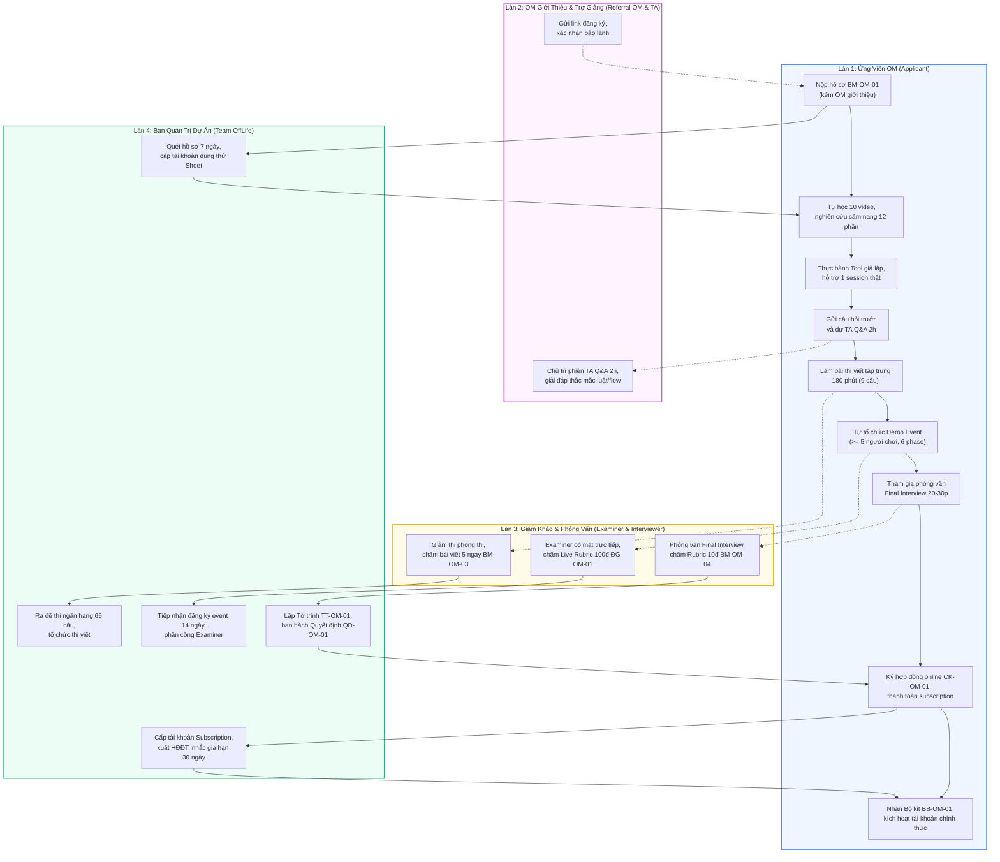

# QUY TRÌNH CHUẨN (SOP) ĐÀO TẠO, SÁT HẠCH & CẤP CHỨNG NHẬN ĐIỀU PHỐI VIÊN OFFLIFE MASTER (CERTIFIED OM)

> **Mã quy trình:** SOP-OM-2026  
> **Phiên bản:** 3.2.0 (Chuẩn hóa đồng bộ 100% theo bản quyền Web tương tác Quy_Trinh_Tuyen_OM_Interactive.html)  
> **Cơ quan ban hành:** Ban Quản lý Dự án & Đào tạo OffLife  
> **Phạm vi áp dụng:** Toàn bộ ứng viên dự tuyển, người điều phối chính thức (Certified OM), Trợ giảng (TA), Giám khảo (Examiner) và Team Vận hành OffLife  
> **Thời gian đào tạo & cấp chứng nhận:** 6 – 10 tuần  

---

## CHƯƠNG I: TỔNG QUAN CHƯƠNG TRÌNH & KHUNG CHỦ THỂ VẬN HÀNH

### 1.1. Mục Tiêu & Phạm Vi Chương Trình
Chương trình **OffLife Master Training Program** chuẩn hóa lộ trình tuyển chọn, đào tạo và cấp chứng nhận cho ứng viên từ khi nộp hồ sơ đến khi trở thành **Certified OffLife Master (OM)** — người có đầy đủ năng lực tự tổ chức và dẫn dắt các sự kiện OffLife độc lập. Chương trình kéo dài từ **6 đến 10 tuần** với 5 giai đoạn thẩm định nghiêm ngặt.

### 1.2. Khung Chủ Thể Trọng Tâm

```
+---------------------------------------------------------------------------------------------------+
|                                 LỘ TRÌNH PHÁT TRIỂN NGHỀ NGHIỆP                                    |
|                                                                                                   |
|    [APPLICANT]  ==========( 6 - 10 tuần qua 5 giai đoạn đào tạo & sát hạch )=========>  [CERTIFIED OM]   |
|  (Ứng viên tham gia)                                                                (OM Chính thức)  |
+---------------------------------------------------------------------------------------------------+
```

#### 1. Ứng Viên (Applicant) — Giai đoạn 1 đến 4
- **Đầu vào:** Cá nhân đã trải nghiệm thực tế phiên workshop OffLife, **bắt buộc có Certified OM giới thiệu** và đạt điểm duyệt hồ sơ Profile Scanning > 6/10đ.
- **Học liệu & Học cụ:** Được cấp quyền truy cập trọn bộ học liệu gồm 10 Video Portal OM Academy (Module 0–9), Hướng dẫn Luật đầy đủ, Cẩm nang Tài liệu Đào tạo OffLife Master (12 phần) và Công cụ Giả lập Kịch bản trên `offlife.vn/sessions/new`.
- **Tài khoản hệ thống:** Được cấp **Tài khoản dùng thử (Trial Account) 1 tháng** ghi nhận chính thức trong Sheet Account List để phục vụ tự học và ôn tập trước kỳ thi.
- **Quyền hạn & Giới hạn:**
  * Được tham gia hỗ trợ tổ chức session thật cùng OM đi trước;
  * Được tham gia buổi giải đáp thắc mắc chuyên sâu trực tiếp cùng Trợ giảng (TA Q&A 2 tiếng);
  * Tự tổ chức buổi Demo Event thực tế có Giám khảo (Examiner) của OffLife có mặt trực tiếp quan sát và chấm điểm;
  * **Tuyệt đối chưa được tự ý tổ chức hoặc điều phối độc lập** bàn chơi thu phí khi chưa được cấp chứng nhận Certified OM.

#### 2. Điều Phối Viên Chính Thức (Certified OM) — Đích đến công nhận
- **Điều kiện đạt chuẩn:** Vượt qua xuất sắc toàn bộ 5 Giai đoạn thẩm định của chương trình (Duyệt hồ sơ, Hoàn thành tự học, Thi viết đạt điểm $\ge 6.5/10$, Demo Event đạt điểm $\ge 65/100$ kèm 2 điểm chặn và Phỏng vấn cuối đạt $\ge 6.5/10$).
- **Pháp lý & Quyền hạn chính thức:**
  * Được ghi danh chính thức vào Danh sách Certified OM của Hệ sinh thái OffLife;
  * **Toàn quyền độc lập tổ chức và dẫn dắt** các sự kiện OffLife tiêu chuẩn (từ 4 đến 8 người chơi/bàn) cho cộng đồng, doanh nghiệp, trường học;
  * Toàn quyền cung ứng dịch vụ điều phối workshop và thụ hưởng quyền lợi kinh tế theo quy định của Dự án.
- **Tài khoản quản trị bản quyền:** Ký kết Hợp đồng dịch vụ phần mềm trực tuyến, mua gói **Subscription** và được kích hoạt tài khoản quản trị chính thức (thu hồi tài khoản dùng thử).
- **Đặc quyền mở rộng:** Quyền phát hành Thư giới thiệu (Referral) và gửi link bảo lãnh ứng viên mới tham gia chương trình đào tạo OM; tham gia các phiên đào tạo cập nhật tính năng mới định kỳ 2 tuần/lần từ đội ngũ R&D.
- **Nghĩa vụ duy trì:** Duy trì chất lượng điều phối, tuân thủ Bộ quy tắc ứng xử (Code of Conduct) và chuẩn mực Zero-Tolerance, gia hạn gói Subscription đúng hạn.

---

### 1.3. Hệ Sinh Thái Phân Vai Trách Nhiệm Vận Hành Đào Tạo (Team OffLife)
Nhằm bảo đảm tính khách quan, minh bạch và chất lượng đầu ra, Team OffLife phân định rõ 5 vai trò vận hành:

1. **OM Giới Thiệu (Referral OM):** Certified OM đang hoạt động, phát hiện người chơi tiềm năng, gửi link Form đăng ký trực tuyến và phát hành xác nhận bảo lãnh ban đầu cho ứng viên.
2. **Trợ Giảng (TA - Teaching Assistant):** Cán bộ phụ trách chuyên môn của OffLife, trực tiếp điều phối buổi **TA Q&A (2 tiếng)** vào cuối tuần thứ 4 của Giai đoạn 2 để giải đáp toàn bộ thắc mắc của ứng viên về luật chơi, cơ chế số phận/may mắn, quản trị 3 nguồn lực Tiền - Sức khỏe - Trí tuệ và kỹ năng xử lý tình huống phát sinh.
3. **Giám Khảo Chấm Thi (OffLife Examiner):** Cán bộ có kinh nghiệm dày dặn từ Team OffLife (hoặc Certified OM kỳ cựu được Ban Điều hành chỉ định), có mặt trực tiếp tại phiên Demo Event của ứng viên để quan sát và chấm điểm định lượng theo *Live Event Scoring Rubric (100 điểm + 10 điểm thưởng)*.
4. **Người Phỏng Vấn (Interviewer):** Cán bộ đại diện Team OffLife (giai đoạn đầu gồm 2–3 người), phụ trách thực hiện phiên phỏng vấn 20–30 phút tại Giai đoạn 5 để thẩm định động lực cá nhân và mức độ phù hợp của định hướng 5 năm với sứ mệnh OffLife.
5. **Ban Quản Trị Dự Án (Team OffLife):** Chịu trách nhiệm tổng thể tiếp nhận hồ sơ, chấm Profile Scanning, ra đề thi từ Ngân hàng 65 câu hỏi, tổ chức phòng thi Written Test, cấp và quản trị tài khoản trên Google Sheet Account List, giao kết hợp đồng Subscription và kích hoạt tài khoản chính thức.

---

### 1.4. Bảng Ma Trận So Sánh Toàn Diện Quyền Hạn & Nghĩa Vụ

| Tiêu Chí So Sánh | Ứng Viên (Applicant) | Điều Phối Viên Chính Thức (Certified OM) |
| :--- | :--- | :--- |
| **Tư cách pháp lý** | Cá nhân dự tuyển, học viên chương trình đào tạo | **Điều phối viên chính thức được công nhận** |
| **Điều kiện tham gia** | Đã chơi OffLife + Được OM giới thiệu + Đạt hồ sơ | Vượt qua trọn vẹn 5 Giai đoạn đào tạo & sát hạch |
| **Tài khoản phần mềm** | Tài khoản dùng thử 1 tháng (Trial Account) để học & ôn thi | **Tài khoản bản quyền Subscription chính thức ghi nhận hệ thống** |
| **Thẩm quyền bàn chơi** | Chỉ hỗ trợ session cùng OM đi trước hoặc làm Demo Event | **Toàn quyền độc lập mở bàn, tổ chức workshop và thu phí** |
| **Quyền giới thiệu người mới**| Chưa được quyền giới thiệu | **Toàn quyền bảo lãnh và gửi link giới thiệu Applicant mới** |
| **Trách nhiệm bảo mật** | Cam kết bảo mật nội dung đào tạo & đề thi | Ký Hợp đồng dịch vụ SaaS + Cam kết NDA & DPA (`CK-OM-01`) |
| **Quy chế duy trì** | Hoàn thành lộ trình 5 giai đoạn trong 6–10 tuần | Duy trì chất lượng điều phối, tuân thủ Code of Conduct, gia hạn Subscription |

---

## CHƯƠNG II: QUY TRÌNH CHI TIẾT 5 GIAI ĐOẠN ĐÀO TẠO, SÁT HẠCH & CẤP PHÉP OM

### 2.1. GIAI ĐOẠN 1: TIẾP NHẬN HỒ SƠ & QUÉT NĂNG LỰC (PROFILE SCANNING)

- **Thời hạn xử lý (SLA):** `07 ngày làm việc`
- **Chủ thể thực hiện & Phối hợp:** Ứng viên OM & Ban Vận hành PMO (Thu Hà)

#### 1. Đầu Vào (Inputs)
Hồ sơ dự tuyển qua Registration Form BM-OM-01, CCCD, thông tin OM giới thiệu, minh chứng đã tham dự tối thiểu 02 phiên OffLife thực tế, xác nhận đồng ý Điều khoản tham gia, Hợp đồng dịch vụ phần mềm dự thảo và Thông báo xử lý dữ liệu cá nhân (DPA).

#### 2. Hành Động Nghiệp Vụ Triển Khai (Actions)
Ứng viên nộp hồ sơ trực tuyến. Team OffLife kiểm tra tính hợp lệ bắt buộc (Có OM giới thiệu + Đồng ý văn bản pháp lý). Đánh giá hồ sơ theo Rubric Profile Scanning 10 điểm (5 tiêu chí: Động lực & gắn kết, Năng lực tổ chức then chốt, Nền tảng phù hợp giá trị, Profile & sức hút người chơi, Định hướng dài hạn).

#### 3. Cổng Kiểm Soát Chất Lượng (Quality Gate)
> **TIÊU CHUẨN ĐÁNH GIÁ CỔNG 1:**  
> Cổng 1: Hồ sơ hợp lệ VÀ Tổng điểm Rubric > 6/10 VÀ Điểm tiêu chí 2 (Năng lực tổ chức) > 1 điểm.

#### 4. Đầu Ra & Luồng Thông Báo (Outputs & Notifications)
• NẾU ĐẠT: Gửi Email EM-OM-01 thông báo ĐẠT Profile Scanning + Cấp tài khoản dùng thử 1 tháng + Gửi tài liệu học tập (10 Video OM Academy, Cẩm nang v3.0, Tool giả lập).
• NẾU CHƯA ĐẠT: Gửi Email EM-OM-02 thông báo cảm ơn, nêu lý do chưa đạt và dừng chương trình.

---

### 2.2. GIAI ĐOẠN 2: ĐÀO TẠO NGHIỆP VỤ TỰ HỌC & HỖ TRỢ THỰC TẾ (ONLINE TRAINING)

- **Thời hạn xử lý (SLA):** `04 tuần (1 tháng)`
- **Chủ thể thực hiện & Phối hợp:** Ứng viên OM & Ban Huấn luyện Đào tạo (Kim Thoa)

#### 1. Đầu Vào (Inputs)
Tài khoản dùng thử 1 tháng (ghi nhận trong Sheet Account List), Series 10 Video OM Academy (Module 0–9), Hướng dẫn Luật OffLife đầy đủ, Cẩm nang đào tạo OffLife Master v3.0 (12 phần), Tool tạo kịch bản giả lập (offlife.vn/sessions/new), Bảng theo dõi BM-OM-02.

#### 2. Hành Động Nghiệp Vụ Triển Khai (Actions)
Ứng viên tự học video và nghiên cứu cẩm nang; dùng Tool tạo kịch bản để tự luyện tập; tham gia hỗ trợ tổ chức tối thiểu 01 session thật cùng OM đi trước; gửi danh sách câu hỏi thắc mắc trước và tham dự buổi TA Q&A trực tiếp (2 tiếng) vào cuối tuần thứ 4.

#### 3. Cổng Kiểm Soát Chất Lượng (Quality Gate)
> **TIÊU CHUẨN ĐÁNH GIÁ CỔNG 2:**  
> Cổng 2: Hoàn thành đủ 4 yêu cầu bắt buộc: (1) Tự học video & cẩm nang, (2) Hỗ trợ ít nhất 1 session thật, (3) Gửi câu hỏi trước, (4) Tham gia trọn vẹn buổi TA Q&A.

#### 4. Đầu Ra & Luồng Thông Báo (Outputs & Notifications)
• NẾU ĐẠT: Gửi Email EM-OM-01 xác nhận hoàn thành Online Training + Thông báo lịch thi viết tập trung Written Test.
• NẾU CHƯA ĐẠT: Gửi Email EM-OM-02 thông báo chưa đủ điều kiện, dừng chương trình (hoặc gia hạn tài khoản 2–4 tuần nếu có lý do chính đáng).

---

### 2.3. GIAI ĐOẠN 3: KỲ THI ĐÁNH GIÁ NĂNG LỰC VIẾT (WRITTEN TEST)

- **Thời hạn xử lý (SLA):** `180 phút (3 tiếng) tại chỗ`
- **Chủ thể thực hiện & Phối hợp:** Ứng viên OM & Hội đồng Giám khảo Sát hạch Chuyên môn

#### 1. Đầu Vào (Inputs)
Đề thi in 9 câu tự luận rút từ Question Bank 65 câu (Part A: 6 câu kỹ thuật mô phỏng; Part B: 3 câu mở cá nhân/đạo đức), Phiếu làm bài thi viết BM-OM-03, Thước đo tiêu chí Rubric Written Test.

#### 2. Hành Động Nghiệp Vụ Triển Khai (Actions)
Thí sinh làm bài thi viết tay độc lập tại chỗ trong 180 phút (khoảng 20 phút/câu). Hội đồng chấm bài theo Rubric Written Test trong vòng 5 ngày làm việc. Đánh giá độ sâu hiểu biết về 3 nguồn lực M/H/I, session flow, giá trị OnLife và phản xạ tuân thủ.

#### 3. Cổng Kiểm Soát Chất Lượng (Quality Gate)
> **TIÊU CHUẨN ĐÁNH GIÁ CỔNG 3:**  
> Cổng 3: Điểm bài thi đạt từ 6.5/10 điểm trở lên và không có câu trả lời vi phạm chuẩn mực đạo đức.

#### 4. Đầu Ra & Luồng Thông Báo (Outputs & Notifications)
• NẾU ĐẠT (≥ 6.5đ): Gửi Email EM-OM-01 thông báo kết quả thi viết + Hướng dẫn chuẩn bị và đăng ký lịch Demo Event.
• NẾU CHƯA ĐẠT: Gửi Email EM-OM-02 thông báo kết quả: Lần 1: Hẹn thi lại sau 2–4 tuần; Lần 2: Email cảm ơn và dừng chương trình.

---

### 2.4. GIAI ĐOẠN 4: SÁT HẠCH THỰC ĐỊA SỰ KIỆN (DEMO EVENT DO ỨNG VIÊN TỰ TỔ CHỨC)

- **Thời hạn xử lý (SLA):** `Trong vòng 4 tuần (Thời lượng phiên: 180 phút)`
- **Chủ thể thực hiện & Phối hợp:** Ứng viên OM (Trưởng BTC Event) & Examiner của OffLife giám sát

#### 1. Đầu Vào (Inputs)
Lịch đăng ký Demo Event (trước ít nhất 14 ngày), Tối thiểu 5 người chơi thật, Địa điểm, Dụng cụ bàn chơi, Logistics do ứng viên tự chuẩn bị, Bảng tiêu chí chấm điểm Live Event Scoring Rubric ĐG-OM-01.

#### 2. Hành Động Nghiệp Vụ Triển Khai (Actions)
Ứng viên tự tổ chức trọn vẹn buổi OffLife bằng nguồn lực riêng và dẫn đủ 6 phase (từ Pre-OffLife đến Feedback Collection). Examiner của OffLife có mặt trực tiếp tại bàn quan sát và chấm điểm độc lập trên Live Rubric 100 điểm (+10 thưởng). Thu thập khảo sát CSAT người chơi.

#### 3. Cổng Kiểm Soát Chất Lượng (Quality Gate)
> **TIÊU CHUẨN ĐÁNH GIÁ CỔNG 4:**  
> Cổng 4: Sự kiện hợp lệ (≥ 5 người chơi, đủ 6 phase) VÀ Tổng điểm ≥ 65/100 VÀ Độ chính xác truyền đạt ≥ 6/10 VÀ Mức độ tin cậy OM ↔ người chơi ≥ 6/10 VÀ Không vi phạm Zero Tolerance.

#### 4. Đầu Ra & Luồng Thông Báo (Outputs & Notifications)
• NẾU ĐẠT: Gửi Email EM-OM-01 chúc mừng đạt Demo Event + Mời tham gia buổi Phỏng vấn cuối cùng (Final Interview).
• NẾU CHƯA ĐẠT: Gửi Email EM-OM-02 kèm feedback chi tiết: Lần 1: Được đăng ký tổ chức lại Demo Event lần 2 trong vòng 4 tuần; Lần 2: Email cảm ơn và dừng chương trình.

---

### 2.5. GIAI ĐOẠN 5: PHỎNG VẤN ĐỊNH HƯỚNG & CÔNG NHẬN CERTIFIED OM (FINAL INTERVIEW & CERTIFICATION)

- **Thời hạn xử lý (SLA):** `20–30 phút phỏng vấn & 03 ngày làm việc hoàn tất thủ tục`
- **Chủ thể thực hiện & Phối hợp:** Ứng viên OM, Hội đồng Phỏng vấn, Ban Vận hành PMO & Project Lead

#### 1. Đầu Vào (Inputs)
Hồ sơ ứng viên, Bài thi Written Test, Kết quả Demo Event, Phiếu phỏng vấn BM-OM-04 (Rubric 10đ: Động lực đúng đắn 7đ + Định hướng nghề nghiệp 5 năm 3đ).

#### 2. Hành Động Nghiệp Vụ Triển Khai (Actions)
Hội đồng phỏng vấn (2–3 người) trao đổi trực tiếp hai chiều, đánh giá con người, động lực thật và độ gắn kết lâu dài. Sau khi đạt, Hội đồng Chuyên môn lập Tờ trình TT-OM-01 trình Project Lead ký Quyết định công nhận QĐ-OM-01; OM thực hiện giao kết Hợp đồng dịch vụ phần mềm/subscription trực tuyến + NDA + DPA (CK-OM-01); kích hoạt tài khoản Subscription chính thức trên manage.html và bàn giao Kit BB-OM-01.

#### 3. Cổng Kiểm Soát Chất Lượng (Quality Gate)
> **TIÊU CHUẨN ĐÁNH GIÁ CỔNG 5:**  
> Cổng 5: Điểm phỏng vấn đạt ≥ 6.5/10 VÀ Không có dấu hiệu vi phạm Code of Conduct VÀ Hoàn tất ký kết Thỏa thuận hợp đồng pháp lý.

#### 4. Đầu Ra & Luồng Thông Báo (Outputs & Notifications)
• NẾU ĐẠT: Gửi Email EM-OM-01 Chúc mừng & Công nhận Certified OffLife Master chính thức + Hướng dẫn giao kết Hợp đồng Subscription, kích hoạt tài khoản manage.html và bàn giao Bộ Kit.
• NẾU CHƯA ĐẠT: Gửi Email EM-OM-02 thông báo cảm ơn và chính sách phỏng vấn lại/dừng chương trình.

---

## CHƯƠNG III: SƠ ĐỒ ĐIỀU HÀNH PHÂN LÀN (SWIMLANE FLOWCHART & MA TRẬN RACI)

### 3.1. Sơ Đồ Quy Trình Phân Làn (Swimlane Flowchart)
Quy trình điều phối được phân định thành **4 làn nghiệp vụ (Swimlanes)** phối hợp đồng bộ và chặt chẽ qua 5 giai đoạn:



---

### 3.2. Ma Trận Trách Nhiệm Nghiệp Vụ (RACI Matrix)

| Chặng Quy Trình | Ứng Viên (Applicant) | OM Giới Thiệu & Trợ Giảng | Giám Khảo & Phỏng Vấn | Ban Quản Trị (Team OffLife) |
| :--- | :---: | :---: | :---: | :---: |
| **Giai đoạn 1: Sàng lọc Hồ sơ (Profile Scanning)** | **R** (Nộp hồ sơ, chọn đồng ý 3 điều khoản) | **C** (Bảo lãnh giới thiệu) | **I** (Theo dõi danh sách) | **A / R** (Kiểm tra hợp lệ, chấm điểm, cấp Trial Account) |
| **Giai đoạn 2: Đào tạo Trực tuyến (Online Training)** | **R** (Tự học, hỗ trợ session, dự Q&A) | **A / R** (Tổ chức buổi TA Q&A 2 tiếng) | **I** (Theo dõi câu hỏi) | **C / I** (Quản lý Sheet Account List, nhắc lịch thi) |
| **Giai đoạn 3: Kỳ thi Viết (Written Test)** | **R** (Làm bài độc lập 180 phút) | **I** (Hỗ trợ ôn tập) | **A / R** (Giám thị và chấm bài theo Rubric) | **C / R** (Ra đề từ ngân hàng 65 câu, gửi kết quả) |
| **Giai đoạn 4: Sự kiện Thực hành (Demo Event)** | **A / R** (Tự tổ chức, mời người chơi, dẫn 6 phase) | **C** (Cố vấn chuyên môn) | **A / R** (Examiner có mặt trực tiếp chấm 100đ + 10đ) | **C / I** (Phân công Examiner, gửi email thông báo kết quả) |
| **Giai đoạn 5: Phỏng vấn & Cấp phép (Certification)** | **R** (Tham gia phỏng vấn, ký hợp đồng, nộp phí) | **I** (Chúc mừng học viên) | **A / R** (Phỏng vấn 2-3 người, chấm Rubric 10đ) | **A / R** (Ban hành QĐ-OM-01, cấp Subscription chính thức) |

*Ghi chú quy ước:*
- **R (Responsible):** Người trực tiếp thực hiện công việc.
- **A (Accountable):** Người chịu trách nhiệm phê duyệt cuối cùng và giải trình kết quả.
- **C (Consulted):** Người được tham vấn chuyên môn, phối hợp hỗ trợ.
- **I (Informed):** Người được thông báo kết quả để nắm tiến độ.

---

## CHƯƠNG IV: MA TRẬN BIỂU MẪU & TRA CỨU NGHIỆP VỤ HỆ THỐNG

Hệ thống vận hành OffLife được chuẩn hóa thành 11 biểu mẫu và văn bản hành chính/pháp lý, bao phủ toàn bộ 5 giai đoạn:

| STT | Mã Hiệu | Tên Biểu Mẫu / Văn Bản Quản Trị | Phân Nhóm | Giai Đoạn Áp Dụng | Đơn Vị Lập | Cấp Phê Duyệt | Thời Hạn (SLA) |
| :---: | :--- | :--- | :--- | :--- | :--- | :--- | :---: |

| 01 | `BM-OM-01` | **Phiếu Đăng ký Dự tuyển & Quét Năng lực Ứng viên (Profile Scanning)** | Tuyển chọn | Giai đoạn recruitment | Ứng viên OM | Team OffLife / PMO | 07 ngày |
| 02 | `BM-OM-02` | **Bảng Theo dõi Tiến độ Đào tạo Online & Quản trị Tài khoản Dùng thử** | Đào tạo | Giai đoạn training | Ứng viên OM & Team OffLife | Ban Huấn luyện | 04 tuần |
| 03 | `BM-OM-03` | **Đề thi Tự luận & Phiếu Chấm Kỳ thi Viết Năng lực (Written Test Scoresheet)** | Sát hạch chuyên môn | Giai đoạn assessment | Giám khảo Hội đồng CM | Hội đồng Chuyên môn | 180 phút |
| 04 | `ĐG-OM-01` | **Bảng Tiêu chí Chấm điểm Thực tế Demo Event (Live Event Scoring Rubric)** | Sát hạch chuyên môn | Giai đoạn assessment | Examiner của OffLife | Hội đồng Chuyên môn | 01 phiên (180p) |
| 05 | `BM-OM-04` | **Biên bản Phỏng vấn Định hướng & Động lực Cá nhân (Final Interview Rubric)** | Sát hạch chuyên môn | Giai đoạn assessment | Hội đồng Phỏng vấn | Hội đồng Chuyên môn | 20–30 phút |
| 06 | `TT-OM-01` | **Tờ trình Đề xuất Công nhận Certified OM & Cấp Quyền Hoạt Động (Chuẩn NĐ 30)** | Hành chính (NĐ 30) | Giai đoạn admin | Hội đồng Chuyên môn | Trưởng Ban Quản lý Dự án | 01 ngày |
| 07 | `QĐ-OM-01` | **Quyết định Công nhận Chức danh Certified OffLife Master (Chuẩn NĐ 30)** | Hành chính (NĐ 30) | Giai đoạn admin | Bộ phận Pháp chế | Trưởng Dự án (Project Lead) | 01 ngày |
| 08 | `CK-OM-01` | **Hợp đồng Dịch vụ Phần mềm (Subscription) + Thỏa thuận Bảo mật (NDA) + DPA** | Pháp lý & Cam kết | Giai đoạn legal | Bộ phận Pháp chế | Project Lead & OM ký | 0.5 ngày |
| 09 | `BB-OM-01` | **Biên bản Bàn giao Bộ Kit Điều Phối & Kích hoạt Tài khoản Quản trị Subscription** | Quản trị tài sản | Giai đoạn asset | Quản trị Kit & Tài khoản | OM tiếp nhận | 0.5 ngày |
| 10 | `EM-OM-01` | **Hệ thống Email Thông Báo Kết Quả ĐẠT (Tích hợp 5 Cổng Kiểm Soát GĐ 1-5)** | Thông báo điện tử | Giai đoạn email | Team Tuyển chọn / PMO | Hệ thống tự động / Lead | Trong ngày |
| 11 | `EM-OM-02` | **Hệ thống Email Thông Báo CHƯA ĐẠT & Phản Hồi Lý Do (Tích hợp 5 Cổng Kiểm Soát)** | Thông báo điện tử | Giai đoạn email | Hội đồng Chuyên môn / PMO | Hệ thống tự động / Lead | Trong ngày |

---

### Chi Tiết Nội Dung & Căn Cứ Nghiệp Vụ Từng Biểu Mẫu

#### 01. Biểu mẫu `BM-OM-01`: Phiếu Đăng ký Dự tuyển & Quét Năng lực Ứng viên (Profile Scanning)
- **Phân nhóm văn bản:** Tuyển chọn
- **Chủ thể lập:** Ứng viên OM
- **Cấp phê duyệt:** Team OffLife / PMO
- **Thời hạn xử lý (SLA):** `07 ngày`
- **Tóm tắt nội dung quy chuẩn:** Bao gồm thông tin định danh cá nhân, CCCD, thông tin OM giới thiệu (bắt buộc), lịch sử tham dự ≥ 02 phiên OffLife thực tế, bản tự đánh giá năng lực và xác nhận tick đồng ý 3 tài liệu pháp lý trực tuyến (Điều khoản tham gia, HĐ phần mềm dự thảo, Thông báo DPA). Chấm theo Rubric Profile 10 điểm (yêu cầu > 6/10 và Năng lực tổ chức > 1).

---

#### 02. Biểu mẫu `BM-OM-02`: Bảng Theo dõi Tiến độ Đào tạo Online & Quản trị Tài khoản Dùng thử
- **Phân nhóm văn bản:** Đào tạo
- **Chủ thể lập:** Ứng viên OM & Team OffLife
- **Cấp phê duyệt:** Ban Huấn luyện
- **Thời hạn xử lý (SLA):** `04 tuần`
- **Tóm tắt nội dung quy chuẩn:** Theo dõi 4 tiêu chí bắt buộc của giai đoạn tự học: (1) Hoàn thành 10 Video bài học OM Academy (Module 0-9) & Cẩm nang v3.0; (2) Thực hành tạo kịch bản với Tool giả lập; (3) Xác nhận tham gia hỗ trợ ít nhất 1 session thật; (4) Phiếu gửi câu hỏi trước và xác nhận tham dự buổi TA Q&A trực tiếp (2 tiếng). Ghi nhận thời hạn tài khoản dùng thử trên Sheet Account List.

---

#### 03. Biểu mẫu `BM-OM-03`: Đề thi Tự luận & Phiếu Chấm Kỳ thi Viết Năng lực (Written Test Scoresheet)
- **Phân nhóm văn bản:** Sát hạch chuyên môn
- **Chủ thể lập:** Giám khảo Hội đồng CM
- **Cấp phê duyệt:** Hội đồng Chuyên môn
- **Thời hạn xử lý (SLA):** `180 phút`
- **Tóm tắt nội dung quy chuẩn:** Đề thi in 9 câu tự luận rút từ Question Bank 65 câu: Part A gồm 6 câu kỹ thuật mô phỏng (Nguyên tắc nền tảng, Core model 3 nguồn lực M/H/I, Metrics tài chính, Session flow); Part B gồm 3 câu mở cá nhân (Động lực, bài học cá nhân, tầm nhìn, giá trị & compliance). Chấm theo thang điểm 10, yêu cầu đạt từ 6.5/10 điểm trở lên.

---

#### 04. Biểu mẫu `ĐG-OM-01`: Bảng Tiêu chí Chấm điểm Thực tế Demo Event (Live Event Scoring Rubric)
- **Phân nhóm văn bản:** Sát hạch chuyên môn
- **Chủ thể lập:** Examiner của OffLife
- **Cấp phê duyệt:** Hội đồng Chuyên môn
- **Thời hạn xử lý (SLA):** `01 phiên (180p)`
- **Tóm tắt nội dung quy chuẩn:** Thang điểm 100 (+10 thưởng) chấm trực tiếp tại Demo Event: Kết quả chính (60đ: Hài lòng người chơi 20đ, Độ trơn tru 6 phases 20đ, Insight OffLife→OnLife 20đ) + Yếu tố khác (40đ: Năng lượng OM 10đ, Năng lượng người chơi 10đ, Độ chính xác truyền đạt 10đ - điểm chặn ≥ 6, Mức độ tin cậy 10đ - điểm chặn ≥ 6). Yêu cầu đạt: Tổng ≥ 65/100, 2 điểm chặn ≥ 6 và không vi phạm Zero Tolerance.

---

#### 05. Biểu mẫu `BM-OM-04`: Biên bản Phỏng vấn Định hướng & Động lực Cá nhân (Final Interview Rubric)
- **Phân nhóm văn bản:** Sát hạch chuyên môn
- **Chủ thể lập:** Hội đồng Phỏng vấn
- **Cấp phê duyệt:** Hội đồng Chuyên môn
- **Thời hạn xử lý (SLA):** `20–30 phút`
- **Tóm tắt nội dung quy chuẩn:** Biên bản đánh giá phỏng vấn cuối cùng sau khi hoàn thành Demo Event: Đánh giá con người và định hướng cá nhân. Rubric chấm điểm 10 điểm gồm: Động lực đúng đắn (0-7 điểm) + Định hướng nghề nghiệp 5 năm (0-3 điểm). Điểm đạt yêu cầu từ 6.5/10 điểm trở lên và không có dấu hiệu vi phạm Code of Conduct.

---

#### 06. Biểu mẫu `TT-OM-01`: Tờ trình Đề xuất Công nhận Certified OM & Cấp Quyền Hoạt Động (Chuẩn NĐ 30)
- **Phân nhóm văn bản:** Hành chính (NĐ 30)
- **Chủ thể lập:** Hội đồng Chuyên môn
- **Cấp phê duyệt:** Trưởng Ban Quản lý Dự án
- **Thời hạn xử lý (SLA):** `01 ngày`
- **Tóm tắt nội dung quy chuẩn:** Soạn thảo theo thể thức Nghị định 30/2020/NĐ-CP: Báo cáo tổng hợp kết quả của ứng viên qua trọn vẹn 5 giai đoạn (Profile Scanning, Online Training, Written Test, Demo Event, Final Interview); đính kèm bảng điểm chi tiết và đề xuất Project Lead ký Quyết định công nhận đạt chuẩn Certified OffLife Master.

---

#### 07. Biểu mẫu `QĐ-OM-01`: Quyết định Công nhận Chức danh Certified OffLife Master (Chuẩn NĐ 30)
- **Phân nhóm văn bản:** Hành chính (NĐ 30)
- **Chủ thể lập:** Bộ phận Pháp chế
- **Cấp phê duyệt:** Trưởng Dự án (Project Lead)
- **Thời hạn xử lý (SLA):** `01 ngày`
- **Tóm tắt nội dung quy chuẩn:** Văn bản hành chính chuẩn Nghị định 30/2020/NĐ-CP: Điều 1: Công nhận danh hiệu Certified OffLife Master (OM); Điều 2: Quyền hạn được tự tổ chức event và mua gói Subscription phần mềm; Điều 3: Trách nhiệm tuân thủ Hợp đồng và Quy chế Zero Tolerance; Điều 4: Hiệu lực thi hành 01 năm kể từ ngày ký.

---

#### 08. Biểu mẫu `CK-OM-01`: Hợp đồng Dịch vụ Phần mềm (Subscription) + Thỏa thuận Bảo mật (NDA) + DPA
- **Phân nhóm văn bản:** Pháp lý & Cam kết
- **Chủ thể lập:** Bộ phận Pháp chế
- **Cấp phê duyệt:** Project Lead & OM ký
- **Thời hạn xử lý (SLA):** `0.5 ngày`
- **Tóm tắt nội dung quy chuẩn:** Bộ văn bản pháp lý ràng buộc 3 trong 1: (1) Hợp đồng cung cấp dịch vụ phần mềm OffLife (gói subscription tự tổ chức event); (2) Thỏa thuận bảo mật thông tin (NDA) về thuật toán, thông số kịch bản; (3) Thỏa thuận xử lý dữ liệu cá nhân (DPA) bảo vệ tuyệt đối thông tin người tham gia theo Nghị định 13/2023/NĐ-CP; cam kết không tư vấn tài chính ngoài đời thực.

---

#### 09. Biểu mẫu `BB-OM-01`: Biên bản Bàn giao Bộ Kit Điều Phối & Kích hoạt Tài khoản Quản trị Subscription
- **Phân nhóm văn bản:** Quản trị tài sản
- **Chủ thể lập:** Quản trị Kit & Tài khoản
- **Cấp phê duyệt:** OM tiếp nhận
- **Thời hạn xử lý (SLA):** `0.5 ngày`
- **Tóm tắt nội dung quy chuẩn:** Kiểm kê hiện vật bàn giao: Hộp trò chơi OffLife nguyên seal, 06 Bộ Player Sheets, Bảng Game Sheet A3, Thẻ định danh OM có QR code; ghi nhận thông tin kích hoạt tài khoản Subscription chính thức trên manage.html, thu hồi tài khoản dùng thử và xuất hóa đơn điện tử.

---

#### 10. Biểu mẫu `EM-OM-01`: Hệ thống Email Thông Báo Kết Quả ĐẠT (Tích hợp 5 Cổng Kiểm Soát GĐ 1-5)
- **Phân nhóm văn bản:** Thông báo điện tử
- **Chủ thể lập:** Team Tuyển chọn / PMO
- **Cấp phê duyệt:** Hệ thống tự động / Lead
- **Thời hạn xử lý (SLA):** `Trong ngày`
- **Tóm tắt nội dung quy chuẩn:** Mẫu email chuẩn hóa gửi cho ứng viên khi ĐẠT bất kỳ giai đoạn nào trong 5 giai đoạn: Xác nhận điểm số đạt chuẩn, cung cấp link/tài liệu bước kế tiếp, cấp tài khoản dùng thử (GĐ 1), mời thi viết (GĐ 2), mời đăng ký Demo Event (GĐ 3), mời phỏng vấn (GĐ 4), và chúc mừng công nhận Certified OM + hướng dẫn mua subscription (GĐ 5).

---

#### 11. Biểu mẫu `EM-OM-02`: Hệ thống Email Thông Báo CHƯA ĐẠT & Phản Hồi Lý Do (Tích hợp 5 Cổng Kiểm Soát)
- **Phân nhóm văn bản:** Thông báo điện tử
- **Chủ thể lập:** Hội đồng Chuyên môn / PMO
- **Cấp phê duyệt:** Hệ thống tự động / Lead
- **Thời hạn xử lý (SLA):** `Trong ngày`
- **Tóm tắt nội dung quy chuẩn:** Mẫu email chuẩn hóa gửi khi ứng viên CHƯA ĐẠT tại bất kỳ giai đoạn nào: Thông báo kết luận văn minh, bảo mật, bắt buộc phân tích rõ căn cứ lý do chưa đạt theo tiêu chuẩn của từng Cổng; nêu rõ chính sách thi lại/demo lại (GĐ 3, GĐ 4 được làm lại 1 lần) hoặc chính sách bảo lưu hồ sơ và hẹn tái dự tuyển.

---

## CHƯƠNG V: TRÌNH SÁT HẠCH ĐÁNH GIÁ DEMO EVENT (LIVE EVENT SCORING RUBRIC)

### 5.1. Bảng Tiêu Chí Chấm Điểm Thực Hành (ĐG-OM-01)
Giám khảo (OffLife Examiner) có mặt trực tiếp tại phiên Demo Event để quan sát và chấm điểm định lượng theo bảng tiêu chí chuẩn mực gồm **7 tiêu chí chính** (100 điểm) và **1 tiêu chí điểm thưởng** (+10 điểm):

| Nhóm Tiêu Chí | STT | Tiêu Chí Đánh Giá Năng Lực | Điểm Tối Đa | Mô Tả Chuẩn Mực Hành Vi |
| :--- | :---: | :--- | :---: | :--- |
| **A. Kết Quả Chính (60 điểm)** | 1 | **Mức độ hài lòng của người chơi (CSAT)** | 20 | Đánh giá qua phiếu khảo sát CSAT sau phiên, cảm xúc tích cực và chia sẻ chân thực của người tham gia. |
| | 2 | **Độ trơn tru của sự kiện (Event Flow)** | 20 | Kiểm soát chuẩn xác và liền mạch 6 phase từ Pre-OffLife đến Feedback Collection, không bị đứt đoạn giáo án. |
| | 3 | **Insight của người chơi (OffLife $
ightarrow$ OnLife)** | 20 | Khơi gợi bài học sâu sắc, giúp người chơi nhìn nhận lại cuộc đời thực tế và định hình kế hoạch hành động. |
| **B. Yếu Tố Khác (40 điểm)** | 4 | **Năng lượng của OM** | 10 | Thần thái tích cực, truyền cảm hứng, làm chủ không gian bàn chơi và cuốn hút sự chú ý. |
| | 5 | **Năng lượng của người chơi** | 10 | Người chơi tập trung, chủ động tương tác, hào hứng thảo luận và không khí bàn chơi sôi nổi. |
| | 6 | **Độ chính xác của thông tin truyền đạt** | 10 | **[BẮT BUỘC &ge; 6Đ - ĐIỂM LIỆT NẾU < 6]** Giải thích chuẩn xác luật, tính toán số liệu tài chính đúng nguyên tắc. |
| | 7 | **Mức độ tin cậy OM $\longleftrightarrow$ Người chơi** | 10 | **[BẮT BUỘC &ge; 6Đ - ĐIỂM LIỆT NẾU < 6]** Tạo không gian cởi mở an toàn, không phán xét, bảo mật thông tin cá nhân. |
| **C. Điểm Thưởng (Bonus)** | + | **Thể hiện xuất sắc vượt trội** | +10 | Sáng tạo phương pháp điều phối độc đáo, xử lý khủng hoảng tâm lý người chơi xuất sắc. |

---

### 5.2. Điều Kiện Công Nhận Đạt Chuẩn Demo Event
Để được công nhận hoàn thành Giai đoạn 4 và tiến vào Giai đoạn 5 (Interview), ứng viên bắt buộc phải thỏa mãn đồng thời cả 4 điều kiện:

$$egin{cases}
	ext{Tổng điểm đạt} \ge 65 / 100 	ext{ điểm} \
	ext{Điểm tiêu chí 6 (Độ chính xác)} \ge 6.0 / 10 	ext{ điểm} \
	ext{Điểm tiêu chí 7 (Mức độ tin cậy)} \ge 6.0 / 10 	ext{ điểm} \
	ext{Không vi phạm Quy tắc ứng xử (Code of Conduct)}
\end{cases}$$

> [!WARNING]
> **Nguyên Tắc Điểm Liệt:** Nếu Tiêu chí 6 hoặc Tiêu chí 7 dưới 6.0 điểm, ứng viên bị kết luận **CHƯA ĐẠT** ngay lập tức, bất kể tổng điểm các tiêu chí khác đạt bao nhiêu.

---

### 5.3. Mẫu Biên Bản Sát Hạch Thực Hành ĐG-OM-01 (In Tiêu Chuẩn A4)

```text
DỰ ÁN GIÁO DỤC OFFLIFE                               CỘNG HÒA XÃ HỘI CHỦ NGHĨA VIỆT NAM
HỘI ĐỒNG GIÁM KHẢO SÁT HẠCH                             Độc lập - Tự do - Hạnh phúc
Số: ...../ĐG-OM-01                                     TP. Hồ Chí Minh, ngày ... tháng ... năm 2026

                        PHIẾU ĐÁNH GIÁ NĂNG LỰC THỰC HÀNH DEMO EVENT
              (OffLife Master Training Program — Giai đoạn 4: Live Event Assessment)

Hôm nay, ngày ... tháng ... năm 2026, tại phiên Demo Event có giám sát, Giám khảo tiến hành chấm điểm:
- Họ và tên ứng viên sát hạch: ................................................................
- Giám khảo chấm thi (OffLife Examiner): .......................................................

BẢNG TỔNG HỢP ĐIỂM SÁT HẠCH ĐỊNH LƯỢNG:
+-----+-------------------------------------------------------+---------------+---------------+
| STT | Nội dung tiêu chí sát hạch                            | Điểm tối đa   | Điểm chấm     |
+-----+-------------------------------------------------------+---------------+---------------+
|  1  | Mức độ hài lòng của người chơi (CSAT)                 | 20 điểm       | ..... / 20    |
|  2  | Độ trơn tru của sự kiện (Event Flow - 6 phase)        | 20 điểm       | ..... / 20    |
|  3  | Insight của người chơi (OffLife -> OnLife)            | 20 điểm       | ..... / 20    |
|  4  | Năng lượng của OM                                     | 10 điểm       | ..... / 10    |
|  5  | Năng lượng của người chơi                             | 10 điểm       | ..... / 10    |
|  6  | Độ chính xác của thông tin [Bắt buộc >= 6đ]           | 10 điểm       | ..... / 10    |
|  7  | Mức độ tin cậy OM <-> Người chơi [Bắt buộc >= 6đ]     | 10 điểm       | ..... / 10    |
|  +  | Điểm thưởng (Bonus - Thể hiện xuất sắc)               | 10 điểm       | +.... / 10    |
+-----+-------------------------------------------------------+---------------+---------------+
|     | TỔNG ĐIỂM SÁT HẠCH DEMO EVENT (Tiêu chuẩn >= 65/100): | 100 điểm      | ..... / 100   |
+-----+-------------------------------------------------------+---------------+---------------+

- Rà soát Code of Conduct: [ ] 0 vi phạm (Đạt chuẩn đạo đức)    [ ] Phát hiện vi phạm
- KẾT LUẬN CỦA GIÁM KHẢO:
  [ ] ĐẠT CHUẨN DEMO EVENT — ĐỀ XUẤT TIẾP VÀO GIAI ĐOẠN 5 (INTERVIEW)
  [ ] CHƯA ĐẠT CHUẨN — HẸN THỰC HIỆN LẠI DEMO EVENT LẦN 2

        ỨNG VIÊN SÁT HẠCH                                GIÁM KHẢO CHẤM THI (EXAMINER)
      (Ký và ghi rõ họ tên)                                  (Ký và ghi rõ họ tên)
```

---

## CHƯƠNG VI: KHO BIỂU MẪU & KHUNG VĂN BẢN MẪU HOÀN CHỈNH (11 MẪU NGUYÊN VĂN NHƯ FILE HTML)

Dưới đây là toàn văn 11 mẫu văn bản quản trị chuẩn Nghị định 30/2020/NĐ-CP, Thỏa thuận dịch vụ pháp lý và Biểu mẫu nghiệp vụ tương ứng 100% với Kho Biểu Mẫu trong tệp `Quy_Trinh_Tuyen_OM_Interactive.html`:

### MẪU 01 (BM-OM-01): PHIẾU ĐĂNG KÝ DỰ TUYỂN & QUÉT NĂNG LỰC ỨNG VIÊN (PROFILE SCANNING RUBRIC)

```text
DỰ ÁN GIÁO DỤC OFFLIFE               CỘNG HÒA XÃ HỘI CHỦ NGHĨA VIỆT NAM
BAN TUYỂN CHỌN & PHÁT TRIỂN OM              Độc lập - Tự do - Hạnh phúc
       ---o0o---                                     ---o0o---
                                              ..., ngày ... tháng ... năm 2026

                               PHIẾU ĐĂNG KÝ DỰ TUYỂN
                  VÀ KHAI TRÌNH NĂNG LỰC OFFLIFE MASTER (OM)
                      (Kèm Rubric Profile Scanning 10 điểm)

I. THÔNG TIN ỨNG VIÊN & ĐIỀU KIỆN TIÊN QUYẾT BẮT BUỘC:
1. Họ và tên: ................................................................ Giới tính: ........
2. Ngày sinh: ...../...../......... Số CCCD: ........................... Ngày cấp: ...../...../.........
3. Số điện thoại: ................................. Email: ............................................
4. Địa chỉ cư trú: ...................................................................................
5. Đơn vị công tác / Nghề nghiệp hiện tại: ...........................................................
6. THÔNG TIN OM GIỚI THIỆU (BẮT BUỘC):
   - Họ tên OM giới thiệu: ....................................... Mã định danh OM: ....................
7. LỊCH SỬ TRẢI NGHIỆM OFFLIFE (TỐI THIỂU 02 PHIÊN THỰC TẾ):
   - Phiên 1: Ngày ...../...../2026 | Địa điểm: ............................. | OM dẫn: ................
   - Phiên 2: Ngày ...../...../2026 | Địa điểm: ............................. | OM dẫn: ................

II. CAM KẾT VĂN BẢN PHÁP LÝ TRỰC TUYẾN (BẮT BUỘC TICK ĐỒNG Ý):
[X] 1. Tôi đã đọc, hiểu rõ và cam kết tuân thủ Điều khoản & Điều kiện tham gia chương trình.
[X] 2. Tôi đã xem xét và đồng ý với nội dung dự thảo Hợp đồng cung cấp dịch vụ phần mềm (Subscription).
[X] 3. Tôi hoàn toàn đồng ý với Thông báo xử lý dữ liệu cá nhân (DPA) theo Nghị định 13/2023/NĐ-CP.

III. PHẦN ĐÁNH GIÁ CHẤM ĐIỂM HỒ SƠ (DÀNH CHO TEAM OFFLIFE - RUBRIC 10 ĐIỂM):
+----+---------------------------------------------------+-----------+------------+
| STT| Tiêu chí đánh giá Profile Scanning                | Thang điểm| Điểm chấm  |
+----+---------------------------------------------------+-----------+------------+
| 1  | Động lực tham gia & Sự gắn kết với giá trị OnLife | 0 - 2 đ   | .......... |
| 2  | Năng lực tổ chức sự kiện & Thu hút người chơi     | 0 - 2 đ   | .......... |
| 3  | Nền tảng chuyên môn & Mức độ phù hợp giá trị      | 0 - 2 đ   | .......... |
| 4  | Profile cá nhân & Sức ảnh hưởng với cộng đồng     | 0 - 2 đ   | .......... |
| 5  | Định hướng dài hạn & Mức độ đầu tư thời gian      | 0 - 2 đ   | .......... |
+----+---------------------------------------------------+-----------+------------+
|    | TỔNG ĐIỂM PROFILE SCANNING                        | / 10 điểm | .......... |
+----+---------------------------------------------------+-----------+------------+

* TIÊU CHUẨN ĐẠT CỔNG 1: Tổng điểm > 6.0/10 điểm VÀ Tiêu chí 2 (Năng lực tổ chức) > 1.0 điểm.
* KẾT LUẬN CỦA BAN TUYỂN CHỌN:
  [ ] ĐẠT YÊU CẦU: Chuyển sang Giai đoạn 2 (Cấp Trial Account 1 tháng & Gửi 10 video OM Academy).
  [ ] CHƯA ĐẠT: Gửi Email cảm ơn EM-OM-02 và dừng chương trình.

         ỨNG VIÊN ĐĂNG KÝ                           CÁN BỘ CHẤM DUYỆT HỒ SƠ
       (Ký và ghi rõ họ tên)                         (Ký và ghi rõ họ tên)
```

---

### MẪU 02 (BM-OM-02): BẢNG THEO DÕI TIẾN ĐỘ ĐÀO TẠO ONLINE & QUẢN TRỊ TÀI KHOẢN DÙNG THỬ

```text
DỰ ÁN GIÁO DỤC OFFLIFE               CỘNG HÒA XÃ HỘI CHỦ NGHĨA VIỆT NAM
BAN ĐÀO TẠO & HUẤN LUYỆN OM                 Độc lập - Tự do - Hạnh phúc
       ---o0o---                                     ---o0o---

                       SỔ THEO DÕI TIẾN ĐỘ ĐÀO TẠO ONLINE
                 VÀ QUẢN TRỊ TÀI KHOẢN DÙNG THỬ (TRIAL ACCOUNT)
                               (Giai đoạn 2 - 04 tuần)

Họ và tên Ứng viên: ........................................ Mã hồ sơ: ..............................
Email nhận tài khoản: ..................................... Số điện thoại: ..........................
Tài khoản Trial cấp ngày: ...../...../2026 | Hết hạn ngày: ...../...../2026 (Sheet Account List)

I. BẢNG KIỂM TRA 4 TIÊU CHÍ BẮT BUỘC ĐỂ HOÀN THÀNH GIAI ĐOẠN 2:
+-----+---------------------------------------------------------+--------------+--------------+
| STT | Nội dung yêu cầu hoàn thành                             | Tiến độ (%)  | Giám sát xác |
|     |                                                         |              | nhận đạt     |
+-----+---------------------------------------------------------+--------------+--------------+
| 1   | Tự học 10 Video OM Academy (Module 0–9) trên Portal     | [ ] 100%     | ............ |
|     | và nghiên cứu Cẩm nang Đào tạo OffLife Master v3.0      |              |              |
+-----+---------------------------------------------------------+--------------+--------------+
| 2   | Thực hành tạo kịch bản giả lập trên Tool mới            | [ ] Đã tạo   | ............ |
|     | (offlife.vn/sessions/new) để làm quen thông số          |              |              |
+-----+---------------------------------------------------------+--------------+--------------+
| 3   | Tham gia hỗ trợ tổ chức ít nhất 01 session thật cùng OM | [ ] Đã hỗ trợ| ............ |
|     | (Ghi rõ ngày: ...../...../2026 | OM chủ trì: .........)  |              |              |
+-----+---------------------------------------------------------+--------------+--------------+
| 4   | Gửi câu hỏi trước và tham dự buổi TA Q&A (2 tiếng)      | [ ] Đã dự    | ............ |
|     | Ngày tổ chức TA Q&A: ...../...../2026                   |              |              |
+-----+---------------------------------------------------------+--------------+--------------+

II. KẾT LUẬN CỦA BAN HUẤN LUYỆN ĐÀO TẠO (CỔNG 2):
[ ] ĐỦ 4 ĐIỀU KIỆN: Đạt Giai đoạn 2 -> Gửi Email EM-OM-01 mời tham dự kỳ thi viết Written Test.
[ ] CHƯA ĐỦ ĐIỀU KIỆN: Dừng chương trình (hoặc gia hạn tài khoản thêm 2-4 tuần nếu có lý do chính đáng).

                                              ..., ngày ..... tháng ..... năm 2026
        ỨNG VIÊN HỌC TẬP                              CÁN BỘ HUẤN LUYỆN (TA)
      (Ký và ghi rõ họ tên)                            (Ký và ghi rõ họ tên)
```

---

### MẪU 03 (BM-OM-03): ĐỀ THI TỰ LUẬN & PHIẾU CHẤM KỲ THI VIẾT NĂNG LỰC (WRITTEN TEST 180 PHÚT)

```text
DỰ ÁN GIÁO DỤC OFFLIFE               CỘNG HÒA XÃ HỘI CHỦ NGHĨA VIỆT NAM
HỘI ĐỒNG SÁT HẠCH CHUYÊN MÔN OM             Độc lập - Tự do - Hạnh phúc
       ---o0o---                                     ---o0o---

                       ĐỀ THI TỰ LUẬN & PHIẾU CHẤM ĐIỂM
                    KỲ THI ĐÁNH GIÁ NĂNG LỰC VIẾT (WRITTEN TEST)
               (Thời lượng: 180 phút | Hình thức: Viết tay tại chỗ)

Họ và tên thí sinh: ....................................... Số báo danh: ...........................
Ngày thi: ...../...../2026 | Địa điểm thi: ..........................................................
Cán bộ coi thi: 1. ........................................ 2. .....................................

I. CẤU TRÚC ĐỀ THI (9 CÂU HỎI TỰ LUẬN RÚT TỪ QUESTION BANK 65 CÂU):
A. PHẦN KỸ THUẬT VẬN HÀNH & NGUYÊN TẮC CỐT LÕI (PART A - 6 CÂU):
   Câu 1 (Core Model): Bản chất tương tác định lượng giữa 3 nguồn lực M (Tiền), H (Sức khỏe), I (Trí tuệ).
   Câu 2 (Session Flow): Quy trình điều hành chuẩn xác 7 bước vòng chơi hàng năm và cách kiểm soát nhịp.
   Câu 3 (Crisis Handling): Kỹ thuật xử lý biến cố phá sản / vỡ nợ và tình huống đột tử (H = 0).
   Câu 4 (Financial Metrics): Ý nghĩa của ngưỡng Độc lập tài chính và cơ chế vận hành quỹ hưu trí.
   Câu 5 (Debriefing): Phương pháp đặt câu hỏi truy vấn bài học quản trị OnLife theo chuẩn 12 phần.
   Câu 6 (Platform Rules): Các giới hạn kỹ thuật và quy tắc kiểm soát hệ thống phần mềm quản trị.

B. PHẦN ĐỘNG LỰC, GIÁ TRỊ & PHẢN XẠ TUÂN THỦ (PART B - 3 CÂU MỞ):
   Câu 7 (Value & Integrity): Phân tích 3 nguyên tắc hoạt động và 4 hành vi vi phạm nghiêm trọng (Zero Tolerance).
   Câu 8 (Personal Reflection): Một bài học bước ngoặt trong cuộc đời thực mà bạn rút ra từ mô phỏng OffLife.
   Câu 9 (Mission Alignment): Vì sao bạn muốn trở thành OffLife Master và bạn cam kết gì với người tham gia?

II. BẢNG ĐIỂM ĐÁNH GIÁ CỦA GIÁM KHẢO (RUBRIC THANG ĐIỂM 10):
+-----+---------------------------------------------------+-----------+------------+
| STT | Nội dung chấm điểm                                | Thang điểm| Điểm đạt   |
+-----+---------------------------------------------------+-----------+------------+
| I   | Phần A: Độ chính xác kỹ thuật & Luật chơi         | 0 - 6.0 đ | .......... |
| II  | Phần B: Động lực, chiều sâu nhận thức & Liêm chính| 0 - 4.0 đ | .......... |
+-----+---------------------------------------------------+-----------+------------+
|     | TỔNG ĐIỂM BÀI THI VIẾT (WRITTEN TEST)             | / 10 điểm | .......... |
+-----+---------------------------------------------------+-----------+------------+

* TIÊU CHUẨN ĐẠT CỔNG 3: Tổng điểm bài thi ≥ 6.5 / 10 điểm.
* KẾT LUẬN:
  [ ] ĐẠT (≥ 6.5đ): Đủ điều kiện đăng ký tự tổ chức Demo Event trong vòng 4 tuần.
  [ ] CHƯA ĐẠT (< 6.5đ): Lần 1 hẹn thi lại sau 2–4 tuần; Lần 2 dừng chương trình.

         GIÁM KHẢO 1                                   GIÁM KHẢO 2
    (Ký và ghi rõ họ tên)                         (Ký và ghi rõ họ tên)
```

---

### MẪU 04 (ĐG-OM-01): BẢNG TIÊU CHÍ CHẤM ĐIỂM THỰC HÀNH DEMO EVENT (LIVE SCORING RUBRIC)

```text
DỰ ÁN GIÁO DỤC OFFLIFE               CỘNG HÒA XÃ HỘI CHỦ NGHĨA VIỆT NAM
HỘI ĐỒNG GIÁM KHẢO SÁT HẠCH                 Độc lập - Tự do - Hạnh phúc
       ---o0o---                                     ---o0o---

                       BẢNG TIÊU CHÍ CHẤM ĐIỂM THỰC HÀNH
                SỰ KIỆN THỰC ĐỊA DO ỨNG VIÊN TỰ TỔ CHỨC (DEMO EVENT)
               (Live Event Scoring Rubric 100 điểm + 10 điểm thưởng)

Họ tên Ứng viên điều phối: ................................. Mã hồ sơ: ............................
Ngày tổ chức: ...../...../2026 | Thời lượng phiên: 180 phút (từ .....h..... đến .....h.....)
Địa điểm tổ chức Demo Event: .......................................................................
Số lượng người chơi thực tế: ..... người (Bắt buộc ≥ 5 người chơi thật)
Giám khảo Examiner có mặt: ..........................................................................

I. BẢNG ĐIỂM SÁT HẠCH ĐỊNH LƯỢNG (EXAMINER CHẤM TRỰC TIẾP):
+----+---------------------------------------------------+-----------+------------+
| STT| Tiêu chí sát hạch Demo Event                      | Điểm tối đa| Điểm chấm |
+----+---------------------------------------------------+-----------+------------+
| A  | KẾT QUẢ CHÍNH (60 ĐIỂM)                           |           |            |
| 1  | Mức độ hài lòng của người chơi (Dựa trên CSAT)    | 20 điểm   | .......... |
| 2  | Độ trơn tru của event (Đủ 6 phase quy trình)      | 20 điểm   | .......... |
| 3  | Insight chuyển hóa của người chơi (OffLife->OnLife)| 20 điểm   | .......... |
+----+---------------------------------------------------+-----------+------------+
| B  | YẾU TỐ BỔ TRỢ & ĐỘ CHÍNH XÁC (40 ĐIỂM)            |           |            |
| 4  | Năng lượng và phong thái điều phối của OM         | 10 điểm   | .......... |
| 5  | Năng lượng và sự hào hứng của người chơi          | 10 điểm   | .......... |
| 6  | Độ chính xác thông tin truyền đạt (ĐIỂM CHẶN ≥ 6) | 10 điểm   | .......... |
| 7  | Mức độ tin cậy OM ↔ Người chơi (ĐIỂM CHẶN ≥ 6)    | 10 điểm   | .......... |
+----+---------------------------------------------------+-----------+------------+
| C  | ĐIỂM THƯỞNG ĐẶC BIỆT (TỐI ĐA +10 ĐIỂM)            |           |            |
| 8  | Kỹ năng xử lý tình huống xuất sắc / Truyền cảm hứng| +10 điểm  | .......... |
+----+---------------------------------------------------+-----------+------------+
|    | TỔNG ĐIỂM DEMO EVENT CUỐI CÙNG                    | / 100 điểm| .......... |
+----+---------------------------------------------------+-----------+------------+

II. RÀ SOÁT QUY CHẾ ZERO TOLERANCE (VI PHẠM BỊ LOẠI NGAY LẬP TỨC):
[ ] Phát hiện hành vi tư vấn tài chính / chào bán bảo hiểm / khóa học ngoài đời thực.
[ ] Phát hiện hành vi thu thập, khai thác trái phép dữ liệu cá nhân của người tham gia.
[ ] Thái độ phán xét, xúc phạm hoặc định kiến nặng nề với người tham gia.

III. KẾT LUẬN CỦA EXAMINER (CỔNG 4):
* Điều kiện đạt: Tổng điểm ≥ 65/100 VÀ Tiêu chí 6 ≥ 6.0 VÀ Tiêu chí 7 ≥ 6.0 VÀ Không vi phạm Zero Tolerance.
[ ] ĐẠT DEMO EVENT: Đủ điều kiện tham gia phỏng vấn cuối cùng (Final Interview).
[ ] CHƯA ĐẠT: Lần 1: Nhận bản feedback và được đăng ký Demo lại; Lần 2: Dừng chương trình.

                                              ..., ngày ..... tháng ..... năm 2026
        ỨNG VIÊN ĐIỀU PHỐI                            EXAMINER CHẤM ĐIỂM
      (Ký và ghi rõ họ tên)                          (Ký và ghi rõ họ tên)
```

---

### MẪU 05 (BM-OM-04): BIÊN BẢN PHỎNG VẤN ĐỊNH HƯỚNG & ĐỘNG LỰC CÁ NHÂN (FINAL INTERVIEW RUBRIC)

```text
DỰ ÁN GIÁO DỤC OFFLIFE               CỘNG HÒA XÃ HỘI CHỦ NGHĨA VIỆT NAM
HỘI ĐỒNG PHỎNG VẤN OM                       Độc lập - Tự do - Hạnh phúc
       ---o0o---                                     ---o0o---

                       BIÊN BẢN PHỎNG VẤN ĐỊNH HƯỚNG
                  VÀ ĐÁNH GIÁ ĐỘNG LỰC CÁ NHÂN (FINAL INTERVIEW)
                     (Thời lượng: 20–30 phút | Thang điểm: 10)

Họ và tên Ứng viên: ........................................ Mã hồ sơ: ..............................
Ngày phỏng vấn: ...../...../2026 | Hình thức: [ ] Trực tiếp  [ ] Trực tuyến (Online)
Hội đồng phỏng vấn: 1. ..................................... 2. .....................................

I. CÁC NỘI DUNG TRAO ĐỔI CHÍNH:
1. Động lực thực chất: "Vì sao bạn chọn tham gia và muốn trở thành OffLife Master?"
2. Nhận diện bản thân: 3 điểm mạnh nổi trội và 3 điểm hạn chế cần cải thiện của ứng viên.
3. Tầm nhìn 5 năm: "5 năm tới bạn sẽ ở đâu trong sự nghiệp và OffLife đồng hành ra sao?"
4. Trao đổi hai chiều: Giải đáp câu hỏi của ứng viên dành cho Đội ngũ Dự án OffLife.

II. BẢNG CHẤM ĐIỂM PHỎNG VẤN (RUBRIC 10 ĐIỂM):
+-----+---------------------------------------------------------+-----------+------------+
| STT | Tiêu chí phỏng vấn                                      | Thang điểm| Điểm đạt   |
+-----+---------------------------------------------------------+-----------+------------+
| 1   | Động lực đúng đắn: Xuất phát từ sự quan tâm đến người    | 0 - 7.0 đ | .......... |
|     | chơi, tin vào sứ mệnh OnLife và mong muốn phát triển;   |           |            |
|     | lý do cụ thể, chân thành, nhất quán với bài thi test.   |           |            |
+-----+---------------------------------------------------------+-----------+------------+
| 2   | Định hướng nghề nghiệp: Lộ trình 5 năm tới phù hợp      | 0 - 3.0 đ | .......... |
|     | với định hướng hệ sinh thái OffLife.                    |           |            |
+-----+---------------------------------------------------------+-----------+------------+
|     | TỔNG ĐIỂM PHỎNG VẤN CUỐI CÙNG                           | / 10 điểm | .......... |
+-----+---------------------------------------------------------+-----------+------------+

* TIÊU CHUẨN ĐẠT CỔNG 5: Tổng điểm ≥ 6.5 / 10 điểm VÀ Không có dấu hiệu vi phạm Code of Conduct.
* KẾT LUẬN CỦA HỘI ĐỒNG:
  [ ] ĐẠT PHỎNG VẤN: Lập Tờ trình TT-OM-01 trình Project Lead ban hành Quyết định công nhận Certified OM.
  [ ] CHƯA ĐẠT: Gửi Email cảm ơn EM-OM-02 và áp dụng chính sách phỏng vấn lại theo quy định.

                                              ..., ngày ..... tháng ..... năm 2026
        ỨNG VIÊN PHỎNG VẤN                         ĐẠI DIỆN HỘI ĐỒNG PHỎNG VẤN
      (Ký và ghi rõ họ tên)                            (Ký và ghi rõ họ tên)
```

---

### MẪU 06 (TT-OM-01): TỜ TRÌNH ĐỀ NGHỊ CÔNG NHẬN ĐẠT CHUẨN & CẤP QUYỀN CERTIFIED OFFLIFE MASTER (CHUẨN NĐ 30)

```text
DỰ ÁN GIÁO DỤC OFFLIFE               CỘNG HÒA XÃ HỘI CHỦ NGHĨA VIỆT NAM
HỘI ĐỒNG CHUYÊN MÔN OM                      Độc lập - Tự do - Hạnh phúc
       ---o0o---                                     ---o0o---
  Số: 12/TTr-HĐCM                              TP. Hồ Chí Minh, ngày ... tháng ... năm 2026

                                    TỜ TRÌNH
         Về việc công nhận đạt chuẩn và cấp chứng chỉ Certified OffLife Master (OM)
                                    Đợt .../2026

                            Kính gửi: BAN QUẢN LÝ DỰ ÁN OFFLIFE

- Căn cứ Kế hoạch phát triển mạng lưới điều phối viên Dự án OffLife giai đoạn 2025 - 2026;
- Căn cứ Tài liệu Đào tạo OffLife Master v3.0 và Chương trình Đào tạo OffLife Master Training Program;
- Căn cứ Kết quả sát hạch toàn diện qua 5 Giai đoạn của Hội đồng Chuyên môn.

Hội đồng Chuyên môn kính trình Ban Quản lý Dự án xem xét và ký Quyết định công nhận chức danh Certified OffLife Master (OM) cho các ứng viên hoàn thành xuất sắc chương trình, cụ thể như sau:

I. TỔNG HỢP TIẾN TRÌNH ĐÀO TẠO & SÁT HẠCH QUA 5 GIAI ĐOẠN:
1. Số lượng ứng viên nộp hồ sơ Giai đoạn 1 (Profile Scanning): ... hồ sơ. Đạt chuẩn: ... ứng viên.
2. Số lượng hoàn thành Giai đoạn 2 (Online Training 4 tuần + Hỗ trợ 1 session + TA Q&A): ... ứng viên.
3. Số lượng tham gia Giai đoạn 3 (Written Test 180 phút): ... thí sinh. Đạt điểm ≥ 6.5/10: ... thí sinh.
4. Số lượng hoàn thành Giai đoạn 4 (Tự tổ chức Demo Event ≥ 5 người): ... ứng viên đạt điểm ≥ 65/100.
5. Số lượng vượt qua Giai đoạn 5 (Final Interview 20-30 phút đạt điểm ≥ 6.5/10): ... ứng viên.

II. DANH SÁCH ỨNG VIÊN ĐỀ NGHỊ CÔNG NHẬN CERTIFIED OM CHÍNH THỨC:
1. Ông/Bà: ....................................... - Mã hồ sơ: ....................................
   - Điểm Written Test: .../10 | Điểm Demo Event: .../100 | Điểm Final Interview: .../10.
   - Nhận xét: Nắm vững nguyên tắc cốt lõi, điều hành trọn vẹn 6 phase sự kiện, động lực chân thành và gắn bó với sứ mệnh OnLife.
2. Ông/Bà: ....................................... - Mã hồ sơ: ....................................
   - Điểm Written Test: .../10 | Điểm Demo Event: .../100 | Điểm Final Interview: .../10.
   - Nhận xét: Năng lực tổ chức sự kiện xuất sắc, phong thái tự tin, phản xạ tuân thủ liêm chính tuyệt đối.

III. KIẾN NGHỊ & ĐỀ XUẤT:
Hội đồng Chuyên môn kính đề nghị Trưởng Ban Quản lý Dự án (Project Lead):
1. Ký ban hành Quyết định công nhận chức danh Certified OffLife Master (QĐ-OM-01) có hiệu lực 01 năm.
2. Giao Bộ phận Vận hành PMO thực hiện ký kết Hợp đồng cung cấp dịch vụ phần mềm / Subscription trực tuyến + Thỏa thuận bảo mật NDA + Bảo vệ dữ liệu cá nhân DPA (CK-OM-01).
3. Bàn giao Bộ Kit vật lý tiêu chuẩn (BB-OM-01) và kích hoạt tài khoản quản trị chính thức manage.html.

Kính trình Ban Quản lý Dự án xem xét và phê duyệt./.

Nơi nhận:                                            TRƯỞNG HỘI ĐỒNG CHUYÊN MÔN
- Như trên;                                                    (Ký và ghi rõ họ tên)
- Ban Vận hành (Thu Hà);
- Lưu: HS Đào tạo.
                                                                     Kim Thoa
```

---

### MẪU 07 (QĐ-OM-01): QUYẾT ĐỊNH CÔNG NHẬN CHỨC DANH CERTIFIED OFFLIFE MASTER (CHUẨN NĐ 30)

```text
DỰ ÁN GIÁO DỤC OFFLIFE               CỘNG HÒA XÃ HỘI CHỦ NGHĨA VIỆT NAM
BAN QUẢN LÝ DỰ ÁN OFFLIFE                   Độc lập - Tự do - Hạnh phúc
       ---o0o---                                     ---o0o---
  Số: 26/QĐ-BQL-OM                             TP. Hồ Chí Minh, ngày ... tháng ... năm 2026

                                   QUYẾT ĐỊNH
              Về việc Công nhận và Cấp Quyền Điều phối viên Certified OffLife Master
                            TRƯỞNG BAN QUẢN LÝ DỰ ÁN OFFLIFE

- Căn cứ Kế hoạch hoạt động và phát triển mạng lưới điều phối viên Dự án OffLife giai đoạn 2025 - 2026;
- Căn cứ Quy chế Đào tạo và Cấp quyền điều phối viên OffLife Master Training Program;
- Xét đề nghị của Trưởng Hội đồng Chuyên môn tại Tờ trình số 12/TTr-HĐCM ngày .../.../2026.

                                   QUYẾT ĐỊNH:

Điều 1. Công nhận chức danh Certified OffLife Master (OM) đối với các nhân sự có tên trong danh sách đính kèm, sau khi đã hoàn thành xuất sắc toàn diện 5 Giai đoạn đào tạo và sát hạch chuyên môn.

Điều 2. Quyền hạn và Trách nhiệm của Certified OffLife Master:
1. Quyền hạn: Được cấp quyền sử dụng thương hiệu và phần mềm OffLife để độc lập tổ chức các phiên mô phỏng; được giao kết hợp đồng dịch vụ phần mềm (Subscription); được cấp mã định danh OM chính thức và có quyền giới thiệu ứng viên mới vào chương trình.
2. Trách nhiệm: Tuyệt đối tuân thủ Quy chế Không khoan nhượng (Zero Tolerance), không đưa ra lời khuyên đầu tư tài chính cá nhân ngoài đời thực, bảo vệ dữ liệu cá nhân của người tham gia và duy trì điểm CSAT trung bình ≥ 4.5/5.0 sao.

Điều 3. Hiệu lực thi hành:
Quyết định này có hiệu lực 01 năm kể từ ngày ký. Các ông/bà có tên tại Điều 1, Hội đồng Chuyên môn và Bộ phận Vận hành PMO chịu trách nhiệm thi hành Quyết định này./.

Nơi nhận:                                            TRƯỞNG BAN QUẢN LÝ DỰ ÁN
- Như Điều 3;                                                  (Ký và ghi rõ họ tên)
- Hội đồng Chuyên môn;
- Lưu: Hồ sơ Pháp chế.
                                                                   Võ Duy Anh
```

---

### MẪU 08 (CK-OM-01): HỢP ĐỒNG CUNG CẤP DỊCH VỤ PHẦN MỀM (SUBSCRIPTION) + NDA + DPA

```text
                       CỘNG HÒA XÃ HỘI CHỦ NGHĨA VIỆT NAM
                            Độc lập - Tự do - Hạnh phúc
                                     ---o0o---

           HỢP ĐỒNG CUNG CẤP DỊCH VỤ PHẦN MỀM (SUBSCRIPTION),
      CAM KẾT BẢO MẬT THÔNG TIN (NDA) & XỬ LÝ DỮ LIỆU CÁ NHÂN (DPA)
                               Số: .../2026/HĐ-OM

Hôm nay, ngày ..... tháng ..... năm 2026, tại TP. Hồ Chí Minh, chúng tôi gồm:
BÊN A (ĐƠN VỊ CUNG CẤP NỀN TẢNG): BAN QUẢN LÝ DỰ ÁN OFFLIFE
Đại diện: Ông Võ Duy Anh                           Chức vụ: Trưởng Ban Quản lý Dự án
Địa chỉ: ................................................................................

BÊN B (ĐIỀU PHỐI VIÊN CERTIFIED OM):
Họ và tên: ....................................... Sinh ngày: ...../...../.........
Số CCCD: ........................... Ngày cấp: ...../...../......... Nơi cấp: .............
Mã định danh Certified OM: OM-2026-............. Email: .................................

Hai bên thống nhất ký kết Hợp đồng với các điều khoản chuẩn hóa sau:

ĐIỀU 1: CUNG CẤP DỊCH VỤ PHẦN MỀM (SUBSCRIPTION TỰ TỔ CHỨC EVENT)
1. Bên A cấp quyền truy cập tài khoản Subscription phần mềm quản trị OffLife (manage.html) cho Bên B để tự tổ chức các phiên mô phỏng cuộc đời theo gói dịch vụ đã đăng ký.
2. Tài khoản chỉ được cấp duy nhất cho Bên B sử dụng; tuyệt đối không chuyển nhượng, chia sẻ mật khẩu hoặc cho bên thứ ba mượn quyền truy cập. Hết hạn subscription mà không gia hạn thì tài khoản tự động bị khóa.

ĐIỀU 2: THỎA THUẬN BẢO MẬT THÔNG TIN HỆ THỐNG (NDA)
1. Bên B cam kết giữ bí mật tuyệt đối các thuật toán ngầm, xác suất biến cố Số Phận - May Mắn, kịch bản thử thách và cơ chế vận hành nội bộ của OffLife.
2. Tuyệt đối không sao chép, làm giả, sửa đổi mã nguồn hoặc thương mại hóa trái phép tài sản trí tuệ thuộc quyền sở hữu của Dự án OffLife.

ĐIỀU 3: THỎA THUẬN XỬ LÝ DỮ LIỆU CÁ NHÂN (DPA - NGHỊ ĐỊNH 13/2023/NĐ-CP)
1. Bên B có nghĩa vụ bảo vệ an toàn thông tin cá nhân của người tham gia workshop (họ tên, email, nghề nghiệp, tình trạng tài chính trong mô phỏng); không được chia sẻ cho bất kỳ bên thứ ba nào.
2. Dữ liệu chỉ được sử dụng cho mục đích phục vụ phiên điều phối và đúc kết OnLife; không được sử dụng để tiếp thị chéo hoặc chào bán sản phẩm dịch vụ bên ngoài.

ĐIỀU 4: QUY CHẾ ZERO TOLERANCE & CHẾ TÀI ĐÌNH CHỈ
1. Nghiêm cấm Bên B đưa ra các khuyến nghị, tư vấn mua cổ phiếu, bất động sản hoặc tư vấn đầu tư tài chính đời thực cho người tham gia.
2. Nếu vi phạm bất kỳ điều khoản nào thuộc Quy chế Zero Tolerance, Bên A có toàn quyền: Lập tức khóa vĩnh viễn tài khoản Subscription, thu hồi danh hiệu Certified OM và yêu cầu bồi thường thiệt hại thực tế phát sinh.

Hợp đồng được lập thành 02 bản có giá trị pháp lý như nhau, mỗi bên giữ 01 bản để thi hành.

       ĐẠI DIỆN BÊN A                                         ĐẠI DIỆN BÊN B
    (Ký và ghi rõ họ tên)                                  (Ký và ghi rõ họ tên)
```

---

### MẪU 09 (BB-OM-01): BIÊN BẢN BÀN GIAO BỘ KIT ĐIỀU PHỐI VẬT LÝ & KÍCH HOẠT TÀI KHOẢN QUẢN TRỊ

```text
DỰ ÁN GIÁO DỤC OFFLIFE               CỘNG HÒA XÃ HỘI CHỦ NGHĨA VIỆT NAM
BỘ PHẬN QUẢN TRỊ KIT & NỀN TẢNG             Độc lập - Tự do - Hạnh phúc
       ---o0o---                                     ---o0o---

                                  BIÊN BẢN BÀN GIAO
           BỘ DỤNG CỤ ĐIỀU PHỐI (KIT OM) VÀ KÍCH HOẠT TÀI KHOẢN SUBSCRIPTION

Hôm nay, ngày ..... tháng ..... năm 2026, chúng tôi gồm có:
BÊN GIAO (BỘ PHẬN VẬN HÀNH OFFLIFE):
Đại diện: Bà Thu Hà                                Chức vụ: Điều phối viên Vận hành PMO

BÊN NHẬN (CERTIFIED OFFLIFE MASTER):
Họ và tên: ....................................... Mã Certified OM: OM-2026-.............

Hai bên tiến hành kiểm kê và bàn giao các hạng mục trang thiết bị tiêu chuẩn:
I. KIỂM KÊ HIỆN VẬT BỘ KIT ĐIỀU PHỐI (MỚI 100%, NGUYÊN SEAL):
1. Hộp trò chơi OffLife Boardgame tiêu chuẩn (kèm bàn cờ, xúc xắc, thẻ bài): 01 bộ [X]
2. Bộ Phiếu ghi cá nhân (Player Sheets) chuẩn: 50 bộ [X]
3. Bảng tổng hợp số liệu Game Sheet A3: 05 tờ [X]
4. Cẩm nang Đào tạo OffLife Master v3.0 (in màu gáy xoắn): 01 quyển [X]
5. Thẻ định danh Certified OM kim loại khắc mã laser có mã QR định danh: 01 thẻ [X]

II. BÀN GIAO QUYỀN TRUY CẬP PHẦN MỀM QUẢN TRỊ (MANAGE.HTML):
1. Tên đăng nhập: .....................................................................
2. Loại gói Subscription đã thanh toán: [ ] 03 tháng   [ ] 06 tháng   [ ] 12 tháng
3. Ngày kích hoạt: ...../...../2026 | Ngày hết hạn: ...../...../2026
4. Tình trạng tài khoản dùng thử cũ: Đã thu hồi và chuyển đổi thành công sang tài khoản chính thức.
5. Tình trạng xuất hóa đơn điện tử: Đã gửi qua email của Bên Nhận.

Bên Nhận cam kết bảo quản tài sản, sử dụng phần mềm đúng thỏa thuận hợp đồng và không chia sẻ tài khoản cho bất kỳ ai.

        ĐẠI DIỆN BÊN GIAO                                     ĐẠI DIỆN BÊN NHẬN
      (Ký và ghi rõ họ tên)                                 (Ký và ghi rõ họ tên)
```

---

### MẪU 10 (EM-OM-01): HỆ THỐNG EMAIL CHUẨN HÓA THÔNG BÁO KẾT QUẢ ĐẠT (5 CỔNG KIỂM SOÁT GĐ 1-5)

```text
================================================================================
MẪU EMAIL THÔNG BÁO KẾT QUẢ ĐẠT TẠI CÁC CỔNG KIỂM SOÁT (EM-OM-01)
Đơn vị gửi: Ban Tuyển chọn & Phát triển OffLife Master (talent@offlife.vn)
================================================================================

1. CỔNG 1 - ĐẠT PROFILE SCANNING (CHUYỂN SANG GIAI ĐOẠN 2):
Tiêu đề: [OffLife OM] Chúc mừng bạn đã hoàn thành Vòng Hồ sơ (Profile Scanning)
Kính gửi Anh/Chị {Tên Ứng Viên},
Ban Tuyển chọn Dự án OffLife xin chúc mừng Anh/Chị đã hoàn thành xuất sắc Vòng thẩm định hồ sơ năng lực (Profile Scanning) với kết quả đạt chuẩn ({Điểm}/10 điểm).
Anh/Chị chính thức bước vào Giai đoạn 2: Online Training (kéo dài 04 tuần).
- Thông tin tài khoản dùng thử 1 tháng: Username: {email} | Pass: {temp_pass}
- Link tự học 10 video OM Academy: https://offlife.vn/learn/videos
- Cẩm nang v3.0 & Tool giả lập: https://offlife.vn/sessions/new
Vui lòng hoàn thành tự học, tham gia hỗ trợ 1 session thật và chuẩn bị câu hỏi cho buổi TA Q&A vào cuối tuần thứ 4.

2. CỔNG 2 - ĐẠT ONLINE TRAINING (CHUYỂN SANG KỲ THI WRITTEN TEST):
Tiêu đề: [OffLife OM] Xác nhận hoàn thành Online Training & Thư mời thi Written Test
Kính gửi Anh/Chị {Tên Ứng Viên},
Chúc mừng Anh/Chị đã hoàn thành trọn vẹn 4 yêu cầu của Giai đoạn Online Training.
Hội đồng Chuyên môn trân trọng kính mời Anh/Chị tham dự Kỳ thi Đánh giá Năng lực Viết (Written Test):
- Thời gian: 09h00 - 12h00 ngày ...../...../2026 (180 phút làm bài viết tay tại chỗ).
- Địa điểm: Văn phòng Dự án OffLife, {Địa chỉ}.
- Nội dung: 9 câu hỏi tự luận (6 câu kỹ thuật Part A + 3 câu mở Part B). Điểm đạt yêu cầu: ≥ 6.5/10.

3. CỔNG 3 - ĐẠT WRITTEN TEST (CHUYỂN SANG DEMO EVENT):
Tiêu đề: [OffLife OM] Kết quả Kỳ thi Written Test & Hướng dẫn tổ chức Demo Event
Kính gửi Anh/Chị {Tên Ứng Viên},
Hội đồng Chuyên môn xin thông báo kết quả bài thi Written Test của Anh/Chị: ĐẠT ({Điểm}/10 điểm).
Anh/Chị đủ điều kiện bước vào Giai đoạn 4: Tự tổ chức Demo Event thực tế trong vòng 04 tuần tới.
- Yêu cầu: Tối thiểu 5 người chơi thật, dẫn đủ 6 phase theo đúng quy chuẩn.
- Vui lòng đăng ký lịch trước ít nhất 14 ngày để OffLife phân công Examiner đến dự và chấm điểm trực tiếp.

4. CỔNG 4 - ĐẠT DEMO EVENT (MỜI PHỎNG VẤN FINAL INTERVIEW):
Tiêu đề: [OffLife OM] Chúc mừng hoàn thành Demo Event & Thư mời Phỏng vấn cuối cùng
Kính gửi Anh/Chị {Tên Ứng Viên},
Dựa trên biên bản chấm điểm Live Scoring Rubric của Examiner, Demo Event của Anh/Chị đạt {Điểm}/100 điểm (Độ chính xác: {Diem1}/10, Mức độ tin cậy: {Diem2}/10).
Hội đồng trân trọng mời Anh/Chị tham gia buổi Phỏng vấn cuối cùng (Final Interview) kéo dài 20–30 phút:
- Thời gian: .....h..... ngày ...../...../2026 | Hình thức: Trực tiếp / Online.

5. CỔNG 5 - CÔNG NHẬN CHÍNH THỨC CERTIFIED OFFLIFE MASTER:
Tiêu đề: [OffLife OM] CHÚC MỪNG BẠN CHÍNH THỨC TRỞ THÀNH CERTIFIED OFFLIFE MASTER!
Kính gửi Anh/Chị {Tên Ứng Viên},
Ban Quản lý Dự án OffLife trân trọng chúc mừng Anh/Chị đã vượt qua toàn diện 5 Giai đoạn và chính thức được công nhận danh hiệu CERTIFIED OFFLIFE MASTER (Mã hiệu: OM-2026-{Mã}).
Đính kèm email là Quyết định công nhận QĐ-OM-01 và Hướng dẫn giao kết Hợp đồng dịch vụ phần mềm (Subscription). Sau khi kích hoạt tài khoản, Anh/Chị sẽ nhận Bộ Kit vật lý và toàn quyền độc lập tổ chức các phiên OffLife!
```

---

### MẪU 11 (EM-OM-02): HỆ THỐNG EMAIL CHUẨN HÓA THÔNG BÁO CHƯA ĐẠT & PHẢN HỒI LÝ DO (5 CỔNG)

```text
================================================================================
MẪU EMAIL THÔNG BÁO KẾT QUẢ CHƯA ĐẠT & PHẢN HỒI LÝ DO CHI TIẾT (EM-OM-02)
Đơn vị gửi: Ban Tuyển chọn & Phát triển OffLife Master (talent@offlife.vn)
================================================================================

1. CỔNG 1 - CHƯA ĐẠT PROFILE SCANNING:
Tiêu đề: [OffLife OM] Thông báo kết quả thẩm định hồ sơ dự tuyển OM
Kính gửi Anh/Chị {Tên Ứng Viên},
Ban Tuyển chọn Dự án OffLife xin chân thành cảm ơn Anh/Chị đã quan tâm và gửi hồ sơ dự tuyển OffLife Master.
Sau khi rà soát đối soát, hồ sơ của Anh/Chị chưa đáp ứng đủ tiêu chuẩn đầu vào của đợt tuyển chọn này, cụ thể:
{Lý do: Chưa có xác nhận từ OM giới thiệu / Điểm Rubric Profile đạt {Điểm}/10 chưa đạt ngưỡng > 6.0 / Tiêu chí năng lực tổ chức chưa đạt}.
Chúng tôi xin phép lưu hồ sơ của Anh/Chị và rất hy vọng có cơ hội hợp tác cùng Anh/Chị trong các đợt tuyển chọn tiếp theo.

2. CỔNG 2 - CHƯA HOÀN THÀNH ONLINE TRAINING:
Tiêu đề: [OffLife OM] Thông báo về tiến độ Giai đoạn Online Training
Kính gửi Anh/Chị {Tên Ứng Viên},
Hết thời hạn 04 tuần của Giai đoạn Online Training, hệ thống ghi nhận Anh/Chị chưa hoàn thành đủ 4 điều kiện tiên quyết ({Lý do cụ thể: Chưa tham gia hỗ trợ session thật / Chưa tham gia buổi TA Q&A}).
Theo quy chế, chương trình đào tạo của Anh/Chị tạm thời dừng tại đây. Tài khoản dùng thử sẽ được thu hồi theo quy định.

3. CỔNG 3 - CHƯA ĐẠT KỲ THI WRITTEN TEST:
Tiêu đề: [OffLife OM] Thông báo kết quả bài thi Written Test
Kính gửi Anh/Chị {Tên Ứng Viên},
Hội đồng Chuyên môn xin thông báo kết quả bài thi Written Test của Anh/Chị đạt {Điểm}/10 điểm (ngưỡng yêu cầu: ≥ 6.5/10 điểm).
- Trường hợp thi lần 1: Anh/Chị được quyền đăng ký ôn tập và thi lại 01 lần duy nhất sau 2–4 tuần. Tài khoản dùng thử của Anh/Chị sẽ được gia hạn tương ứng.
- Trường hợp thi lần 2: Anh/Chị chưa đạt yêu cầu điểm sàn, chương trình chính thức dừng tại đây. Chân thành cảm ơn sự nỗ lực của Anh/Chị.

4. CỔNG 4 - CHƯA ĐẠT DEMO EVENT:
Tiêu đề: [OffLife OM] Bản nhận xét chuyên môn & Kết quả Demo Event
Kính gửi Anh/Chị {Tên Ứng Viên},
Căn cứ biên bản quan sát thực tế của Examiner tại Demo Event ngày ...../...../2026, phiên điều phối của Anh/Chị chưa đạt tiêu chuẩn công nhận ({Lý do: Điểm tổng {Điểm}/100 chưa đạt ngưỡng 65đ / Điểm độ chính xác {Diem1}/10 < 6 / Vi phạm quy chế}).
- Đính kèm là Bản nhận xét chuyên môn chi tiết từ Examiner.
- Nếu là Demo Event lần 1: Anh/Chị có tối đa 04 tuần để chuẩn bị và đăng ký tổ chức lại Demo Event lần 2.

5. CỔNG 5 - CHƯA ĐẠT PHỎNG VẤN CUỐI CÙNG (FINAL INTERVIEW):
Tiêu đề: [OffLife OM] Thông báo kết quả buổi Phỏng vấn cuối cùng
Kính gửi Anh/Chị {Tên Ứng Viên},
Hội đồng Phỏng vấn xin chân thành cảm ơn Anh/Chị đã dành thời gian tham gia buổi trò chuyện phỏng vấn định hướng.
Sau khi cân nhắc kỹ lưỡng về sự phù hợp giữa định hướng cá nhân và mục tiêu dài hạn của Dự án OffLife, Hội đồng rất tiếc chưa thể công nhận danh hiệu Certified OM cho Anh/Chị ở thời điểm hiện tại.
Chúc Anh/Chị luôn gặt hái nhiều thành công trong sự nghiệp và cuộc sống!
```

---
